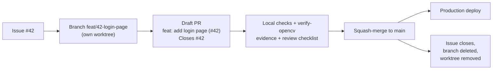

# Contributing: Git workflow

This is how we work in the opencv repo. It applies to people and coding agents alike.
Agents: read `AGENTS.md` first. Details for each topic live in `docs/git-workflow/`.

**There is no CI (no GitHub Actions).** Rules are enforced by GitHub settings (ruleset, CODEOWNERS), local Git hooks, the scripts in `scripts/`, and the review checklist. Local hooks can be bypassed, so the review is the real gate.

## The short version

Every change starts as a GitHub issue, gets its own short-lived branch, comes back through one PR, and lands on `main` as one squash commit. `main` is always deployable, and every merge goes straight to production.



## 1. `main` is the only permanent branch

- `main` is always deployable.
- Nobody commits or pushes to `main` directly. Every change goes through a PR.
- There are no `develop`, `staging`, or `release/` branches.

## 2. Every change starts with an issue

- No issue, no branch. This applies to people and agents, with no exceptions.
- Agents create the issue themselves when none exists, before branching.
- The only PRs without an issue are Dependabot/Renovate dependency updates.
- If an issue needs more than a few days of work, split it into sub-issues. Each sub-issue gets its own branch and PR.
- Assign yourself before you start, so nobody duplicates the work.
- Use the issue forms: Feature, Bug, or Chore/refactor/docs.

## 3. Branch naming

`type/<issue#>-short-description`, for example `feat/42-login-page` or `fix/57-cart-total`.

| Type       | Use for                              |
| ---------- | ------------------------------------ |
| `feat`     | New features                         |
| `fix`      | Bug fixes                            |
| `hotfix`   | Urgent production fixes              |
| `refactor` | Code changes with no behavior change |
| `chore`    | Dependencies, config, tooling        |
| `docs`     | Documentation only                   |

- The issue number is always required.
- Lowercase kebab-case, 3-5 words.
- Always branch from the latest `origin/main`.
- The pre-push hook rejects any other name, and the reviewer checks it. See `docs/git-workflow/branch-naming.md`.

## 4. Worktrees

- **Required for agents, optional for people.** Several agents share one machine; worktrees keep their files apart.
- Location: `../opencv.worktrees/<issue#>-short-description`, next to the main checkout.
- The main checkout stays on `main` and is only used to fetch and create worktrees.
- Each worktree has its own dependency install, its own `.env` (copied from `.env.example`), and its own dev port.
- Git refuses to check out one branch in two worktrees, so two agents can't work on the same branch.
- Remove the worktree after the PR merges.
- `scripts/new-task.sh` and `scripts/cleanup-worktree.sh` do all of this. See `docs/git-workflow/worktrees.md`.

## 5. Pull requests

- Open the PR early. A draft is fine. Use `heavy -- scripts/open-pr.sh [--draft]` (`heavy` caps the run; see AGENTS.md section 4): it validates the branch, runs the quick check (`scripts/check.sh --changed`), pushes, and fills in the title and body.
- Title: `type: description (#<issue>)`, for example `feat: add login page (#42)`. It becomes the commit message on `main`.
- Body: the PR template with the `Closes #42` line.
- Before merge, the PR needs:
  - passing checks: the quick `scripts/check.sh --changed` on each push, and the full `scripts/check.sh` (lint, typecheck, test) once, by the reviewer
  - local verification with the verify-opencv skill (`.claude/skills/verify-opencv`), with its evidence attached to the PR
  - an approval after the review checklist
- A branch behind `main` needs no rebase: the reviewer tests the merge of `main` and the PR. Rebase only when the review reports a merge conflict: `git fetch origin && git rebase origin/main && heavy -- git push --force-with-lease`.
- See `docs/git-workflow/commit-and-pr-conventions.md`.

### Who approves

- The **review agent** clears PRs once its checklist passes (`scripts/review-pr.sh`) and an independent review has no open finding. Then the PR merges; no human approval is needed, env and secrets changes included (a committed real `.env` file fails the checklist).
- A **human** decides only super important changes: a mass deletion (the PR deletes 25% or more of the files on `main` or 80% or more of one app or package; a rename counts as a deletion) or a big decision.
- **Anyone** can add the `needs-human-review` label to flag a big decision. Then only a human may approve it. The review agent never merges a labeled PR.
- People can read, comment on, and block (request changes on) any PR.
- See `docs/git-workflow/review-and-approval.md`.

## 6. Merging and deploying

- Squash-merge is the only merge method. Each PR lands as one commit on `main`.
- There are no preview deploys yet: verify locally with the verify-opencv skill (`.claude/skills/verify-opencv`) and attach its evidence.
- A merge to `main` deploys **straight to production**. There is no staging environment and no staging step.
- After the merge, the issue closes automatically (from `Closes #42`), the remote branch is deleted automatically, and you remove your worktree.

## 7. Hotfixes

1. Open an issue (Bug form, `hotfix` label).
2. Branch `hotfix/<issue#>-short-description` from `main`.
3. Open the PR right away (`heavy -- scripts/open-pr.sh`). Checks must still pass. The review agent runs its checklist immediately.
4. Squash-merge. It deploys like any other change.

If the fix is risky or will take time, first roll back to the previous production deploy on the hosting platform, then fix forward calmly. See `docs/git-workflow/deploys-and-hotfixes.md`.

## 8. Releases and versions

- There are no release branches. Every merge to `main` is a release.
- Tag a version (`vX.Y.Z`) only when you need one: a changelog, a client update, or a public API.
- Use `release/` branches only if we ever ship versioned releases or support several versions at once. Agree on that as a team first.

## 9. Guardrails (set up once per repo)

| Guardrail              | Where        | What it does                                                                                                                            |
| ---------------------- | ------------ | --------------------------------------------------------------------------------------------------------------------------------------- |
| Ruleset on `main`      | GitHub       | Requires a PR (1 approval: one account, see `docs/git-workflow/review-and-approval.md`), linear history; blocks force-push and deletion |
| Merge settings         | GitHub       | Squash only, PR title as commit message, branches auto-deleted after merge                                                              |
| `CODEOWNERS`           | GitHub       | Names the owner of every path; `review-pr.sh` notes env/secrets paths                                                                   |
| `pre-push` hook        | Local        | Blocks pushes to `main` and bad branch names; runs `scripts/check.sh --changed` (quick, scoped to what changed)                         |
| `commit-msg` hook      | Local        | Blocks commits on `main`; rejects empty messages                                                                                        |
| `pre-commit` hook      | Local        | Rejects a staged file over 5000 tokens (bytes / 4); binary files and `linguist-generated` files in `.gitattributes` are skipped         |
| `scripts/open-pr.sh`   | Local        | Correct PR title and `Closes #`, quick check before push                                                                                |
| `scripts/review-pr.sh` | Review agent | Verifies the PR and runs the checks in a clean worktree                                                                                 |
| Templates              | GitHub       | PR template; Feature, Bug, Chore issue forms                                                                                            |
| Labels                 | GitHub       | `feat`, `fix`, `hotfix`, `refactor`, `chore`, `docs`, `needs-human-review`                                                              |
| Dependabot             | GitHub       | Weekly grouped npm version updates (no GitHub Actions)                                                                                  |

Local hooks are on once `git config core.hooksPath .githooks` is set in your clone (`scripts/new-task.sh` does it). Anyone can skip them with `--no-verify`. Don't, because the reviewer re-runs everything.

### Setup

Run these once per repo (the owner does the GitHub settings steps):

1. `git config core.hooksPath .githooks` in the main checkout; worktrees share it.
2. Apply the ruleset: `gh api -X POST repos/quanvu309/opencv/rulesets --input .github/rulesets/main.json` (or `PUT` it to the existing id, see `docs/git-workflow/review-and-approval.md`).
3. Merge settings: squash only, PR title as the squash title, blank squash message, auto-merge off, delete branch on merge.
4. Check `gh api repos/quanvu309/opencv/codeowners/errors --jq '.errors | length'` reads `0`.
5. Labels (`.github/labels.yml` is the source of truth): create each one with `gh label create <name> --color <hex> --description <text> --force`.

Hosting is Railway behind Cloudflare (web, api and Postgres); `docs/deploy.md` describes it. Per-branch previews are pending.

## Cheatsheet

```bash
# One-time per clone: turn on the local hooks (new-task.sh also does this)
git config core.hooksPath .githooks

# Start a task (creates branch + worktree from origin/main, .env, port, install)
scripts/new-task.sh feat 42 -d "login page"
scripts/new-task.sh fix "Cart total rounds wrong"     # creates the issue first

# Work
cd ../opencv.worktrees/42-login-page
git add -p && git commit -m "add login form"
scripts/check.sh --changed                             # quick lint, typecheck, test of what changed (full run: heavy -- scripts/check.sh)

# Open a draft PR (validates, runs the quick check, pushes, fills title + Closes #)
heavy -- scripts/open-pr.sh --draft

# Rebase only when the review reports a merge conflict (a branch behind main is fine)
git fetch origin && git rebase origin/main && heavy -- git push --force-with-lease

# Ready for review / merge
gh pr ready
gh pr merge --squash            # or --auto

# Flag a big decision for a human
gh pr edit --add-label needs-human-review

# Review a PR (review agent, from the main checkout)
heavy -- scripts/review-pr.sh 57                       # OK: gh pr merge 57 --squash

# Clean up merged worktrees (run from the main checkout)
scripts/cleanup-worktree.sh             # all merged
scripts/cleanup-worktree.sh 42          # just #42
git worktree list

# Without the script (people who don't use worktrees)
git fetch origin && git switch -c feat/42-login-page --no-track origin/main
```
