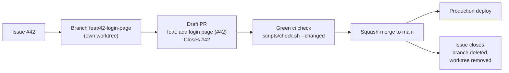

# Contributing: Git workflow

This is how we work in the opencv repo. It applies to people and coding agents alike.
Agents: read `AGENTS.md` first. Details for each topic live in `docs/git-workflow/`.

**CI is one workflow on a free self-hosted runner** (`.github/workflows/ci.yml`; no GitHub-hosted Actions minutes). GitHub requires a pull request and a green `ci` check. Local hooks catch mistakes early. A skipped hook is not caught again at merge.

## The short version

Every change starts as a GitHub issue, gets its own short-lived branch, comes back through one PR, and lands on `main` as one squash commit. `main` is always deployable, and every merge goes straight to production.



## 1. `main` is the only permanent branch

- `main` is always deployable.
- Nobody commits or pushes to `main` directly. Every change goes through a PR.
- There are no `develop`, `staging`, or `release/` branches.

## 2. Every change starts with an issue

- No issue, no branch. This applies to people and agents, with no exceptions.
- Agents create the issue themselves when none exists, before branching.
- The only PRs without an issue are Dependabot/Renovate dependency updates.
- If an issue needs more than a few days of work, split it into sub-issues. Each sub-issue gets its own branch and PR.
- Assign yourself before you start, so nobody duplicates the work.
- Use the Task form (type, What and why, Done when, Risk), or `scripts/ocv-tools.mjs file`.

## 3. Branch naming

`type/<issue#>-short-description`, for example `feat/42-login-page` or `fix/57-cart-total`.

| Type       | Use for                              |
| ---------- | ------------------------------------ |
| `feat`     | New features                         |
| `fix`      | Bug fixes                            |
| `hotfix`   | Urgent production fixes              |
| `refactor` | Code changes with no behavior change |
| `chore`    | Dependencies, config, tooling        |
| `docs`     | Documentation only                   |

- The issue number is always required.
- Lowercase kebab-case, 3-5 words.
- Always branch from the latest `origin/main`.
- The pre-push hook rejects any other name. The `ci` check does not. See `docs/git-workflow/branch-naming.md`.

## 4. Worktrees

- **Required for agents, optional for people.** Several agents share one machine; worktrees keep their files apart.
- Location: `../opencv.worktrees/<issue#>-short-description`, next to the main checkout.
- The main checkout stays on `main` and is only used to fetch and create worktrees.
- Each worktree has its own dependency install, its own `.env` (copied from `.env.example`), and its own dev port.
- Git refuses to check out one branch in two worktrees, so two agents can't work on the same branch.
- Remove the worktree after the PR merges.
- `scripts/ocv-tools.mjs take` and `cleanup` do all of this. See `docs/git-workflow/worktrees.md`.

## 5. Pull requests

- Open the PR early. A draft is fine. Use `scripts/open-pr.sh [--draft]`: it validates the branch, runs the quick check (`pnpm check`), pushes, and fills in the title and body.
- Title: `type: description (#<issue>)`, for example `feat: add login page (#42)`. It becomes the commit message on `main`.
- Body: the PR template with the `Closes #42` line.
- Before merge, the PR needs a green `ci` check. That check is the quick `scripts/check.sh --changed`. Nothing runs the full lint, typecheck and test before a merge.
- Run the verify-opencv skill (`.claude/skills/verify-opencv`) by hand when you want it. Nothing requires its evidence.
- Rebase when the PR does not merge cleanly with `main`: `git fetch origin && git rebase origin/main && git push --force-with-lease`.
- See `docs/git-workflow/commit-and-pr-conventions.md`.

### Who approves

- An agent under the owner's account merges its own PR with `scripts/merge-pr.sh` once `ci` is green. One account, so no approval. Env and secrets changes included. Do not commit a real `.env` file.
- A **human** decides a big decision. Flag it with `needs-human-review`. A mass deletion is not detected; add the label yourself.
- **Anyone** can add the `needs-human-review` label. An agent never merges a labeled PR.
- People can read and comment on any PR.
- See `docs/git-workflow/review-and-approval.md`.

## 6. Merging and deploying

- Squash-merge is the only merge method. Each PR lands as one commit on `main`.
- There are no preview deploys yet. Run the verify-opencv skill (`.claude/skills/verify-opencv`) by hand when you want it.
- A merge to `main` deploys **straight to production**. There is no staging environment and no staging step.
- After the merge, the issue closes automatically (from `Closes #42`), the remote branch is deleted automatically, and you remove your worktree.

## 7. Hotfixes

1. Open an issue (Bug form, `hotfix` label).
2. Branch `hotfix/<issue#>-short-description` from `main`.
3. Open the PR right away (`scripts/open-pr.sh`). `ci` must be green. Merge with `scripts/merge-pr.sh`.
4. Squash-merge. It deploys like any other change.

If the fix is risky or will take time, first roll back to the previous production deploy on the hosting platform, then fix forward calmly. See `docs/git-workflow/deploys-and-hotfixes.md`.

## 8. Releases and versions

- There are no release branches. Every merge to `main` is a release.
- Tag a version (`vX.Y.Z`) only when you need one: a changelog, a client update, or a public API.
- Use `release/` branches only if we ever ship versioned releases or support several versions at once. Agree on that as a team first.

## 9. Guardrails (set up once per repo)

| Guardrail               | Where       | What it does                                                                                                                                                                              |
| ----------------------- | ----------- | ----------------------------------------------------------------------------------------------------------------------------------------------------------------------------------------- |
| Ruleset on `main`       | GitHub      | Requires a PR and the `ci` check (no approval count: one account, see `docs/git-workflow/review-and-approval.md`), squash only, linear history; no bypass; blocks force-push and deletion |
| Merge settings          | GitHub      | Squash only, PR title as commit message, branches auto-deleted after merge                                                                                                                |
| `CODEOWNERS`            | GitHub      | Names the owner of every path, including env and secrets paths                                                                                                                            |
| `pre-push` hook         | Local       | Blocks pushes to `main` and bad branch names; runs `pnpm check` (quick, scoped to what changed)                                                                                           |
| `commit-msg` hook       | Local       | Blocks commits on `main`; rejects empty messages                                                                                                                                          |
| `pre-commit` hook       | Local       | Rejects a staged file over 5000 tokens (bytes / 4); binary files and `linguist-generated` files in `.gitattributes` are skipped                                                           |
| `scripts/open-pr.sh`    | Local       | Correct PR title and `Closes #`, quick check before push                                                                                                                                  |
| `scripts/merge-pr.sh`   | Owner agent | Merges when `ci` is green: owner author, not a draft, no `needs-human-review`, gate files carry `risk:high`                                                                               |
| Templates               | GitHub      | PR template; Task issue form                                                                                                                                                              |
| Labels                  | GitHub      | `feat`, `fix`, `hotfix`, `refactor`, `chore`, `docs`, `needs-human-review`, `ready-for-human`                                                                                             |
| `scripts/pr.mjs doctor` | Local       | Diffs GitHub labels, the `main` ruleset and repo settings against git and prints the fixing `gh` command                                                                                  |

Local hooks are on once `git config core.hooksPath .githooks` is set in your clone (`scripts/ocv-tools.mjs take` does it). Anyone can skip them with `--no-verify`. Don't. A skipped hook is not caught again at merge. `ci` still runs the quick check.

### Setup

Run these once per repo (the owner does the GitHub settings steps):

1. `git config core.hooksPath .githooks` in the main checkout; worktrees share it.
2. Apply the ruleset: `gh api -X POST repos/quanvu309/opencv/rulesets --input .github/rulesets/main.json` (or `PUT` it to the existing id, see `docs/git-workflow/review-and-approval.md`).
3. Merge settings: squash only, PR title as the squash title, blank squash message, auto-merge off, delete branch on merge.
4. Check `gh api repos/quanvu309/opencv/codeowners/errors --jq '.errors | length'` reads `0`.
5. Labels, ruleset and repo settings: `node scripts/pr.mjs doctor` lists every drift from git with the `gh` command that fixes it (`.github/labels.yml` is the label source of truth).

Hosting is Railway behind Cloudflare (web, api and Postgres); `docs/deploy.md` describes it. Per-branch previews are pending.

## Cheatsheet

```bash
# One-time per clone: turn on the local hooks (`take` also does this)
git config core.hooksPath .githooks

# Start a task (creates branch + worktree from origin/main, .env, port, install)
scripts/ocv-tools.mjs take 42 -d "login page"
scripts/ocv-tools.mjs take "Cart total rounds wrong" --what ... --done ... --risk low   # files the issue first

# Work
cd ../opencv.worktrees/42-login-page
git add -p && git commit -m "add login form"
pnpm check                                         # quick lint, typecheck, test of what changed (full run: pnpm check:full)

# Open a draft PR (validates, runs the quick check, pushes, fills title + Closes #)
scripts/open-pr.sh --draft

# Rebase when the PR does not merge cleanly with main
git fetch origin && git rebase origin/main && git push --force-with-lease

# Ready, then merge once ci is green (from the main checkout)
gh pr ready
scripts/merge-pr.sh 57

# Flag a big decision for a human. An agent will not merge it.
gh pr edit --add-label needs-human-review

# Clean up merged worktrees (run from the main checkout)
scripts/ocv-tools.mjs cleanup --all       # all merged
scripts/ocv-tools.mjs cleanup 42          # just #42
git worktree list

# Without the script (people who don't use worktrees)
git fetch origin && git switch -c feat/42-login-page --no-track origin/main
```
