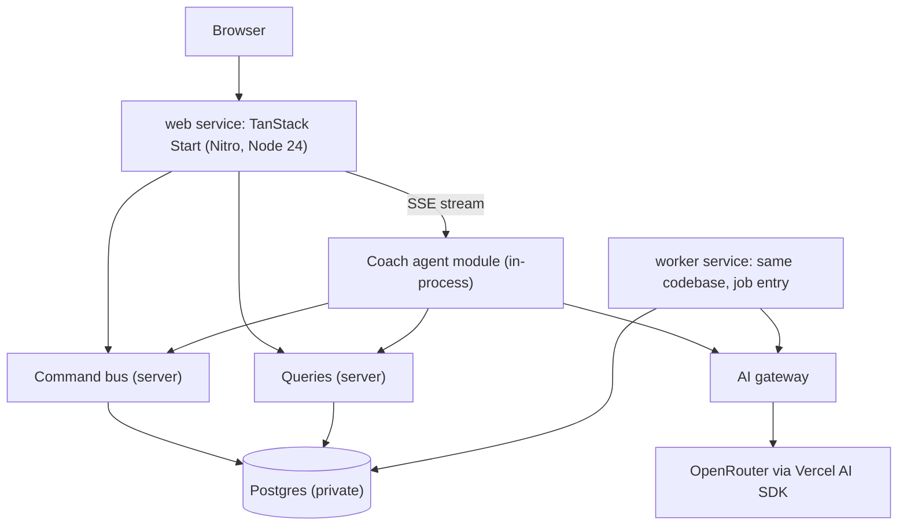
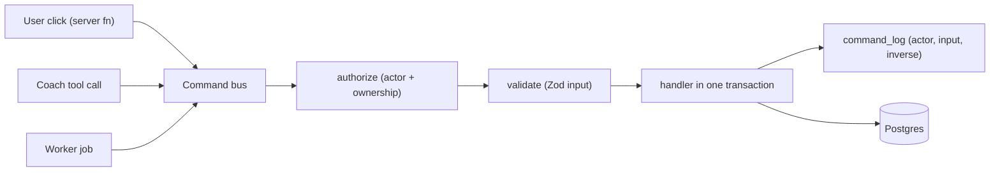

# Architecture

How OpenPath is built and why. The product concept lives in [PRODUCT.md](../PRODUCT.md); per-feature specs live in [docs/features/](features/); decisions are logged in [docs/adr/](adr/).

## Two tracks

Every feature is explicitly on one of two tracks, and the tracks are built differently.

**Track A — Commodity.** Standard surfaces users already know from other apps. We clone the best reference pattern and do not reinvent; novelty on this track is a bug. Built fast on shadcn and proven UX patterns.

**Track B — Signature.** OpenPath's own Interaction Model. These mechanisms get careful design, their own room in the schema, and explicit extension points, because more unique mechanisms will be added over time. Each has a deep design doc in [mechanisms/](mechanisms/); when a new mechanism is invented, it starts as a new doc there, written before the code.

| Feature | Track | Cloned from / mechanism |
|---|---|---|
| Coach chat surface | Commodity | ChatGPT / Claude conversation patterns |
| Coach operates the app | Signature | the command bus (below) |
| Profile | Commodity | LinkedIn-style sectioned editor |
| Paper (CV + cover letter) | Commodity | Resume.io / Kickresume builder, Teal tailoring |
| Proof | Signature | the evidence engine |
| Share and public pages | Signature | substrate for sharing, invitations, social mechanics |
| Pitch | Commodity | interview-prep answer bank |
| Search | Commodity | Teal / Huntr ranked openings list |
| Application (place: Apply) | Commodity | Teal / Huntr status tracker |
| Navigation / signed-in shell | Commodity | ChatGPT threads + Linear groups |
| Onboarding | Commodity | goal-first wizard, activation checklist |
| Landing, auth, settings, notifications | Commodity | standard SaaS patterns |

The three signature mechanisms:

1. **The Coach operates the product.** A change the Coach makes is identical to one the user makes by hand: same command, same undo, same audit trail. This is the command bus, and every future mechanism plugs into it. Deep design: [mechanisms/coach-hands.md](mechanisms/coach-hands.md).
2. **Proof, the evidence engine.** Not a document type. A user builds up evidence of work and skills over time with AI support: log work as it happens, let the Coach interview the specifics out (what it was, what they did, what came of it), arrange the log into a story, publish it as a designed page, connect it outward (a CV line, the personal page). Deep design: [mechanisms/proof.md](mechanisms/proof.md); spec: [features/proof.md](features/proof.md).
3. **Public identity and sharing.** Handle, personal page, per-Proof share pages, and a token-based share model whose capability field reserves room for vouches and invitations. Deep design: [mechanisms/share.md](mechanisms/share.md); spec: [features/share.md](features/share.md).

Proof is its own feature module and domain, beside Paper, not inside it ([ADR 0005](adr/0005-proof-own-domain.md)). In the rail it sits under Paper; that is IA only. Paper stays a clean clone of the resume-builder category; Proof owns the evidence log, publishing, and the sharing graph. Places, groups, and the four navigation channels: [flows.md](flows.md), [features/navigation.md](features/navigation.md).

## System



One codebase, two Railway services, one Postgres ([ADR 0001](adr/0001-modular-monolith-on-railway.md)).

| Service | What | Public |
|---|---|---|
| `web` | TanStack Start: UI, API, Coach streaming | yes |
| `worker` | Same image, different entry: drains the job queue (search ingestion, notifications, email, scheduled work) | no |
| Postgres | All state | no |

Push to `main` deploys both services. The web process applies pending migrations before it listens. Without an AI key the Coach shows an honest offline state and everything else keeps working. Details: [hosting.md](hosting.md).

The Coach runs in-process as an isolated module, `src/features/coach/agent/`, behind a boundary strict enough to extract into its own service later ([ADR 0004](adr/0004-coach-in-process.md)).

## The command bus

Every state change — a user click, a Coach tool call, a worker job — is a named command executed on the server ([ADR 0002](adr/0002-command-bus.md)).



- A command is defined once with `defineCommand`: name (`paper.create`, `proof.log`, `application.setStatus`), Zod input schema, a one-sentence description, the handler, an inverse for undo, and an `agent` flag saying whether the Coach may call it.
- The UI calls commands through TanStack Start server functions. The Coach's tools are generated from the same registry — name, description, and schema become the tool definition — so human and agent capability cannot drift.
- Handlers run in one transaction and return `{ result, inverse }`. The bus writes `command_log` with the actor (`user`, `coach`, `system`) and the inverse invocation. Undo executes the inverse through the bus, linked to the original log row.
- Reads are plain per-feature server queries fetched with TanStack Query and invalidated when a command completes. The server is the single source of truth; multiple tabs and devices just work.
- Future signature mechanics (vouches, invitations, social actions) arrive as new commands and inherit undo, audit, and Coach operability for free.

## Codebase structure

Feature-first and screaming: the tree names the product, not the framework.

```
src/
  routes/                    thin TanStack file routes; each delegates to a feature screen
    index.tsx  sign-in.tsx  sign-up.tsx  onboarding.tsx
    _app/                    signed-in shell: the four layers of docs/layout.md (main, chrome = rail + bell, dock, overlays)
      coach.tsx  profile.tsx  paper/  proof/  pitch.tsx  search.tsx  applications.tsx  settings.tsx
    _public/                 p.$slug.tsx (published Proof), u.$handle.tsx (personal page)
    api/                     coach stream, files, og images
  features/<name>/           coach, profile, paper, proof, pitch, search, application,
                             onboarding, auth, landing, settings, share
    model.ts                 types + Zod schemas, the single source of shape truth
    commands.server.ts       named writes, registered on the bus
    queries.server.ts        reads
    screens/                 what a route renders
    components/              feature UI
    ai.server.ts             feature-owned AI functions, only where needed
    *.test.ts                colocated tests
  core/                      cross-cutting, no product nouns
    db/                      pg client, tx helper, numbered SQL migrations
    commands/                defineCommand, bus, registry, log, undo
    ai/                      gateway, model roles, guardrails, traces, evals
    auth/                    sessions, hashing, request middleware
    notifications/           event to in-app inbox + email
    jobs/  email/  config/
  ui/                        shadcn primitives and shared layout pieces
  styles/globals.css         design tokens
docs/                        this pack
scripts/                     dev, db, worker entry, railway build/start
```

Rules that keep it maintainable for humans and agents:

- Every feature module has the same internal shape. An agent that has seen one has seen all.
- Routes contain no logic. Re-designing a screen touches `screens/` and `components/` only; models, commands, and queries are untouched.
- `core/` never imports from `features/`. Features reach each other only through exported models or commands, never each other's internals.
- Every feature has a spec in `docs/features/` and the spec ships in the same PR as the code it describes.
- No empty folders. `ai.server.ts` exists only where a feature owns AI behaviour.

## Reads, writes, and state

| Kind | How |
|---|---|
| Write | A command on the bus. No other write path exists. |
| Read | `queries.ts` via TanStack Query (`createServerFn` RPC), invalidated on command completion. Server helpers stay in `*.server.ts`. |
| Forms | TanStack Form for real forms (auth, onboarding, settings) |
| Tables | TanStack Table for tabular lists |
| Validation | Zod at every boundary: search params, command inputs, API bodies |
| UI-local state | React state; never persisted, never visible to the Coach |

## Data

Relational Postgres; JSONB only where content is a document body. Schema, table list, command log semantics, and migration workflow: [data.md](data.md) ([ADR 0003](adr/0003-relational-schema.md)).

## AI

Three layers — gateway, Coach agent, task AI — plus a trust layer of guardrails, traces, budgets, and evals: [ai.md](ai.md).

## Testing

`node --test`, colocated `*.test.ts`. Command handlers are tested through the bus, and fixtures are built by executing commands, so tests exercise the real write path. Database tests run in throwaway schemas and skip when `TEST_DATABASE_URL` is absent.

## Deferred by design

Documented as later, not built in v1: monetization, language switcher (English UI first), vouch and invitation mechanics (schema-ready only), parsing uploaded files, the employer side.

## Doc index

| File | Job |
|---|---|
| [README.md](../README.md) | Run the app |
| [AGENTS.md](../AGENTS.md) | Conventions: module template, command rules, recipes |
| [architecture.md](architecture.md) | This file |
| [data.md](data.md) | Schema, migrations, command log |
| [ai.md](ai.md) | Gateway, agent, guardrails, traces, evals |
| [flows.md](flows.md) | Information architecture and core flows |
| [layout.md](layout.md) | Screen regions, layout types, empty states |
| [copy.md](copy.md) | Voice, mechanics, lexicon, per-surface copy |
| [design.md](design.md) | Tokens, voice, accessibility |
| [hosting.md](hosting.md) | Railway services, env, deploy |
| [stack.md](stack.md) | Tech lookup |
| [adr/](adr/) | Decision log |
| [mechanisms/](mechanisms/) | Deep design docs for the signature mechanisms |
| [features/](features/) | One spec per feature |
| [paper.md](paper.md), [../PRODUCT.md](../PRODUCT.md) | Product concept references |
