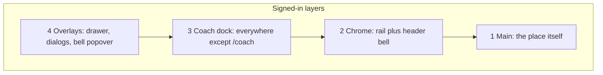

# Layout and hierarchy

Where things sit on each screen, in what order, and what must never compete. This is the logic of space — regions, reading order, one primary action — not pixels, color, or motion; those live in [tokens.md](tokens.md) and [motion.md](motion.md). Where you can go and how you move is [flows.md](../flows.md); the shell itself is [features/navigation.md](../features/navigation.md).

The users arrive anxious, in short sessions, on mid-range Android phones. Layout serves that: every screen answers "what do I do next" by position alone, before a word is read.

## Shared law

Every signed-in screen is the same four layers. The order is the hierarchy: when two layers fight, the lower number wins and the higher yields.

Rules that hold on every screen:

- **One primary action per screen**, in a stable slot: the leading edge of the band on artifact screens, the composer on Chat. If two things compete, one of them is wrong. Secondary actions sit after the primary or in a row menu.
- **Reading order:** skip link, then rail (or drawer trigger), then header, then `main`, then dock. Tab order matches visual order; there is exactly one `main` landmark per page.
- **Main is the artifact.** The dock must not cover the primary action. The drawer covers the map, never the artifact's band.
- **Order by importance.** The most important content sits at the top and the leading edge. The band (title, primary action) is always first inside `main`.
- **Group with space, not lines.** The gap between groups is at least twice the gap within a group. Hairlines only in dense lists (Paper rows, the Apply pipeline).
- **One content inset per group.** Section headings sit outside the group's surface; every text column inside starts on the same vertical line. Padding never drifts per row, and a leading control never pushes its text off the shared edge — the group must read as one composition, not independent blocks.
- **Controls look interactive.** A row that opens is a row, styled as one; a button has a shape. Never a control styled like adjacent static text.
- **Empty, loading, error, and not-found occupy the content slot** — the same place the content would sit, under the same band. Never a different page chrome, never a blank screen. Loading is a skeleton in place, not a spinner over nothing.
- **Break when the content stops fitting**, not at device presets: the rail becomes a drawer, the dock becomes a sheet. No bottom tabs ([flows.md](../flows.md) care).
- **Plan for growth.** Vietnamese strings and names grow and stack tone marks; no fixed-width text containers, rows wrap, the account control never clips "Nguyễn Thị Ngọc Ánh".

## Layout types

Nine types. Every URL in [flows.md](../flows.md) maps to exactly one. A new screen picks a type or extends this list — it does not invent a private layout.

1. **Conversation** — `/coach`. The thread is the body; the composer is the primary slot. On an empty thread the invite, starters, and composer sit as one centered group (ChatGPT empty). Once there are messages the composer pins after the thread. No dock; the page is the conversation.
2. **Drive list** — `/paper`, `/proof`, `/search`, `/applications`. A band (title, one primary action, optional filter) over a single column of rows. The row is the unit: opening one is the row's whole job, not an in-row editor. The empty state replaces the rows under the same band.
3. **Opened document** — `/paper/$paperId`. Band: Back (to the list, never to Chat), title, type word, Export as primary. Then a format bar, a muted stage, and the white A4. No form beside the page; editing happens on the page.
4. **Opened space** — `/proof/$proofId`. Band: Back, title, Arrange and Publish (Publish becomes primary once the story is arranged; until then Arrange is). The body is the log, newest first.
5. **Sectioned editor** — `/profile`, `/pitch`, `/settings`. One column of labelled sections, edited in place. Completeness or the handle sits inside the first section as a fact with its basis, never as a hero metric.
6. **Wizard** — `/onboarding`. No rail. One question per step, skip always visible, payback visible in the same frame as the answer lands. Primary is Continue.
7. **Auth card** — `/sign-in`, `/sign-up`. Centered `--surface-1` card: form column, then a `--surface-2` mark panel from `md`. Heading, the fields, one primary, a text link to the other mode.
8. **Public canvas** — `/`, `/p/$slug`, `/u/$handle`. No rail, no dock, no bell. Landing is a sticky public nav, a centered hero with the product in it, then how it works. On a Proof page and a personal page the work is the page; OpenPath chrome is at most a quiet footer.
9. **Overlay** — dock, drawer, bell popover, confirm dialog. Focus trap, Esc and scrim close, focus restores to the opener. An overlay is never a place: it has no URL and the screen behind it stays live in the map.

## Per-screen instances

Each block: type, regions in reading order, the primary slot, what yields when space runs out, and where empty or error sits.

### Coach — Conversation

Regions: thread messages, then composer. Primary: the composer. Yields: nothing — the conversation owns the column; the checklist and starters disappear once the thread has messages. Empty/error slot: the empty thread holds a centered mark, the composer, and the email connect banner; a failed turn is a plain message in the thread with one retry.

### Paper list — Drive list

Regions: band (title, Start a CV as primary, Start a letter and I already have a file as quiet secondaries), type filter (All / CV Resume / Letter / Uploaded, only when there are items), then the content slot. The content slot yields among: loading skeleton, first-run or cleared empty, filtered empty, error, CV gallery, letter chooser, or rows (name, type word, updated). Gallery and letter chooser replace the rows in that slot; they do not overlay and they are not a modal. Primary: Start a CV. Yields: the filter collapses into the band menu before the primary ever moves; row metadata wraps before names truncate. Empty/error: occupies the content slot under the same band; the one door is Start a CV.

### Opened CV or letter — Opened document

Regions: band (Back to `/paper`, title, type word, Export), format bar (density, then section hide; on an open CV, completeness as a fact in this row), muted stage, then the white A4. Primary: Export. Yields: band and format bar stay; the stage and page scroll; the format bar wraps under the band before Export leaves the band. The dock must not cover Export. A letter with no situation uses the content slot for the letter chooser first, then the A4. Empty/error: missing paper is not-found under the same Back band; a failed export reports in place with one retry; the page never blanks. Loading: band plus a page-shaped skeleton on the stage. Print hides rail, dock, band, and format bar.

### Proof list — Drive list

Regions: band (title, Log something as primary), then rows (thing, status: logged / arranged / published). Primary: Log something. Yields: row metadata wraps before truncating. Empty/error: replaces the rows; teaches what already counts as evidence, one door.

### Opened Proof — Opened space

Regions: band (Back to `/proof`, title, Arrange, Publish), then the log newest first. Primary: Arrange until the story is arranged, then Publish. Only one of the two renders as primary at a time. Yields: the log scrolls; the band holds. Empty/error: an empty log inside a Proof offers Log the first entry.

### Pitch — Sectioned editor

Regions: sections in order — bio, intro, answers — each labelled, edited in place. Primary: the build door when unbuilt; per-section save is quiet. Yields: sections stack; never columns. Empty/error: an unbuilt Pitch is one door (build it from the profile); a built-but-thin section shows its own next step.

### Search — Drive list

Regions: band (title, the query), then ranked rows (opening, fit shown with its working). Detail is **in-page state**: the row pushes to a detail in the same column and Back within the page returns to the list — no detail URL. Primary: the query; on a detail, Save to Apply. Yields: ranked metadata wraps. Empty/error: no query yet is first-run (what Search does, one door); no results is filtered (say the query is why, offer to widen); a failed search says so with retry.

### Apply — Drive list

Regions: band (title), then the pipeline grouped by status (interested / applied / interviewing / offer / rejected). Status is a control on the row, not a second page. Primary: nothing global — the row is the unit; Save happens on Search, tailoring starts from the row. Yields: status groups stack. Empty/error: replaces the pipeline; points at Search as the one door.

### Profile — Sectioned editor

Regions: identity first (name, goal), then facts by section, completeness as a fact with its basis inside the first section ("N of 100, from what you actually provided"). Primary: fill the emptiest section; once complete enough, the door to build the first CV. Yields: sections stack. Empty/error: unfilled sections show the payback for filling them, per the onboarding skip contract.

### Settings — Sectioned editor

Regions: account (email, password, sign out), public page, notifications, danger last. Primary: none global; each section has its own quiet action. Destructive actions sit last and confirm via Overlay. Empty/error: per section, in place.

### Onboarding — Wizard

Regions: the question, the answer control, payback in the same frame, then Continue and Skip. Primary: Continue. Yields: nothing collapses — one question per step is already minimal. Empty/error: a failed save keeps the step, states it, one retry.

### Auth — Auth card

Regions: `/sign-in` and `/sign-up` share a `--surface-1` card, form column then a `--surface-2` mark panel from `md`. Heading, fields, primary, the link to the other mode. Primary: Sign in or Create account. Empty/error: field errors are sentences under the field; a failed submit keeps every value.

### Landing, Proof page, personal page — Public canvas

Landing: sticky public nav, then hero (promise, product composer), then waitlist, then a quiet footer. Anatomy cloned from [onyx.app](https://onyx.app/) ([clone-sources.md](clone-sources.md)). Proof page: the published work is the whole page; quiet footer. Personal page: the span record, each Proof a door to `/p/$slug`. No signed-in chrome anywhere.

### Dock, drawer, bell, confirm — Overlay

Dock: same conversation as `/coach`, composer usable, artifact still operable, never covers the primary action; closed it leaves a compact reopen control at the bottom-right. Leaving `/coach` opens the dock on the same thread; Open Coach in the header returns to `/coach`. Desktop dock is 20rem by at most 32rem. Drawer: the whole rail logic, 16rem, from 768px down; focus trapped. Bell: list of notifications, each a door to its subject; empty is one sentence. Confirm: destructive only, names the noun, two buttons.

## Empty states

An empty state is a layout state: it occupies the content slot under the same band, and its words obey [copy.md](../copy.md). Feature specs carry the exact copy; this is the law that copy must pass.

Five kinds, never conflated:

1. **First-run** — the place has never held anything. Teach what it is in one sentence, then one door. "No proof yet. Log the first thing you're making."
2. **Cleared** — the user emptied it. Do not re-teach; acknowledge and offer the door. No mourning copy.
3. **Filtered** — content exists but the filter or query hides it. Say the filter is why and offer to clear or widen it. Never show the first-run state here.
4. **Error** — the load failed. Say what failed in one sentence, one retry. Never dress an error as an empty state.
5. **Offline or degraded** — the Coach unavailable and similar; the copy specced in [features/coach.md](../features/coach.md) is the reference.

Anatomy, in fixed order: one sentence of what this place is or why it is empty; an optional basis line, never invented; one primary action. No illustrations, no mascots, no jokes about emptiness — the users are anxious, and the empty state is a calm hand, not a personality moment. Loading is a skeleton, never an empty state shown early.

Coach-aware rule: where the natural next step is a conversation, the one primary action may open the dock with a prefilled intent. Never two equal doors. A quiet secondary is allowed only when it reads as clearly subordinate — Paper's "I already have a file" upload, Proof's "I don't have one yet" chip ([mechanisms/proof.md](../mechanisms/proof.md) owns that one).

Per-screen empty inventory:

| Screen | Kind(s) it can show | The one door |
|---|---|---|
| Coach (empty thread) | first-run | mark, composer, starters |
| Paper | first-run, cleared, filtered (by type) | Start a CV |
| Proof | first-run (teaches what counts), cleared | Log something — may open the dock with intent |
| Search | first-run (no query), filtered (no results), error | run or widen the query |
| Apply | first-run, cleared | go to Search |
| Pitch | first-run (unbuilt), thin-section | build from the profile |
| Profile | unfilled sections (payback shown) | fill the emptiest section |
| Bell | empty | none — "No notifications yet." is complete |
| Thread list (rail) | first-run | New conversation |

## Out of scope

Visual craft (radius, shadow — [tokens.md](tokens.md)), motion ([motion.md](motion.md)), component anatomy ([components.md](components.md)), the channel contract ([flows.md](../flows.md)), copy voice ([copy.md](../copy.md)), any UI code.
