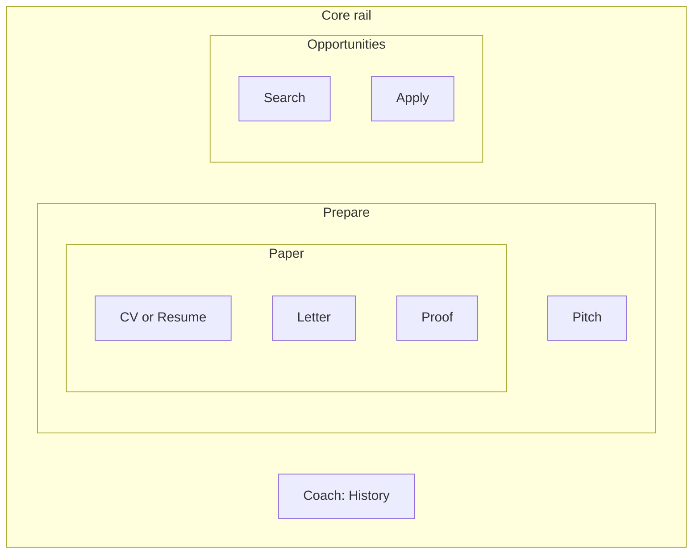
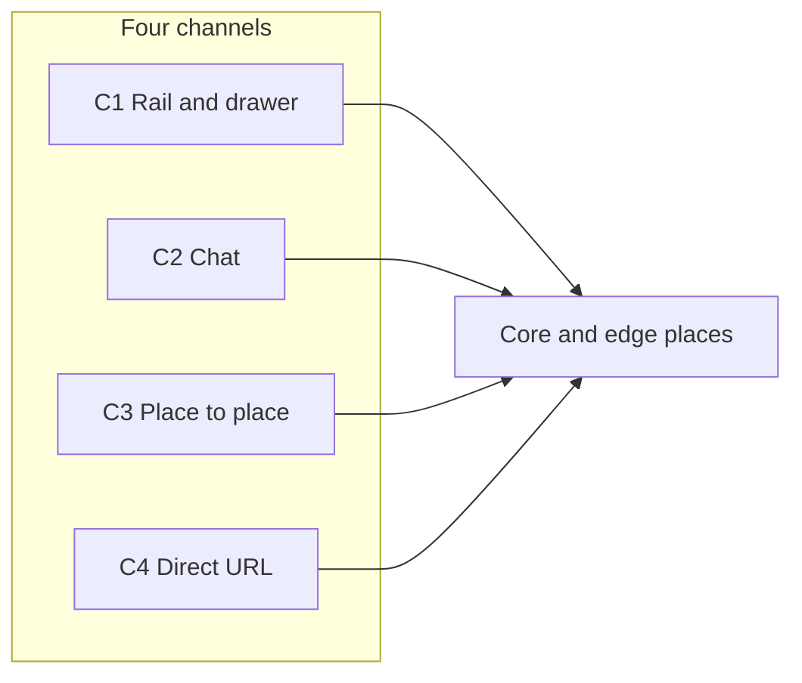
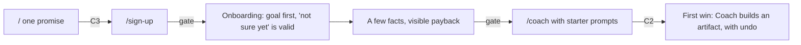
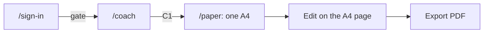
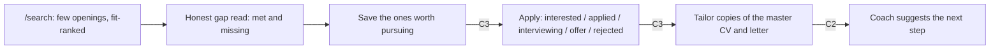
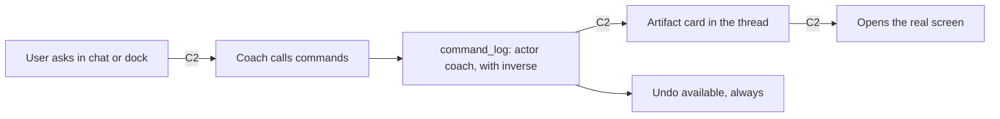
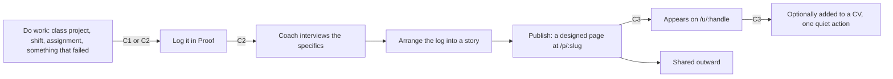

# Information architecture and flows

The conversation is the product; every other screen is an artifact the conversation produced or reads from. Users arrive anxious, in short sessions, often on mid-range Android phones. Every screen must answer "what do I do next" before they leave it.

This file is the map. It answers four questions, in this order: what is the core nav, what is edge-case nav, how do you move, and what more needs care. Product journeys come after, each arrow named by its channel. The shell itself is specified in [features/navigation.md](features/navigation.md); what sits where on each screen is [layout.md](design-system/layout.md).

## 1. Core nav

Everyday places. Always in the signed-in rail. Groups are labels, not pages.

| Place | Kind | URL | Channels |
|---|---|---|---|
| Coach | home | `/coach` | C1, C2, C4 |
| Prepare | group label | none | C1 only (it is not a page) |
| Paper | place under Prepare | `/paper`, `/paper/$paperId` | C1, C2, C3, C4 |
| Proof | opened from Paper | `/proof`, `/proof/$proofId` | C2, C3, C4 (C1 marks Paper) |
| Pitch | place under Prepare | `/pitch` | C1, C2, C4 |
| Opportunities | group label | none | C1 only (it is not a page) |
| Search | place under Opportunities | `/search` | C1, C2, C3, C4 |
| Apply | place under Opportunities | `/applications` | C1, C2, C3, C4 |

- **Coach** (`/coach`): home. A place row in the rail, New conversation, and History (the thread list). Signing in lands here. No dock on this page; the page is the conversation. Thread history lives only in the rail, not a second list on the page.
- **Prepare** (label only): things you make and say.
  - **Paper** (`/paper`): one A4 CV. Empty is a dashed page. A published Proof is a line on it. Proof still has `/proof` URLs and its own domain ([ADR 0005](adr/0005-proof-own-domain.md), [ADR 0008](adr/0008-published-proof-on-paper-cv.md)); it is not a paper type and it is not a rail row. Opened from Paper, a Coach card, or a URL. `/proof` marks Paper.
  - **Pitch** (`/pitch`): bio, intro, answers. What they share.
- **Opportunities** (label only): things you pursue.
  - **Search** (`/search`): fit-ranked openings.
  - **Apply** (`/applications`): the tracker. Verb on purpose. Not "Applications." The route stays `/applications` until a later rename.

Prepare and Opportunities never have their own page. The word Applications does not appear in the UI.

## 2. Edge-case nav

Infrequent, once-per-life, or off the rail. Same app, not in the core list. These must not compete with Coach / Prepare / Opportunities in the rail.

| Place | Kind | URL | Channels |
|---|---|---|---|
| Land | public | `/` | C4 |
| Auth | public | `/sign-in`, `/sign-up` | C4 |
| Onboarding | signed in, once | `/onboarding` | C4; completing it is a gate to Chat |
| Account: Profile | control | `/profile` | C1 (account control), C2, C4 |
| Account: Settings | control | `/settings` | C1 (account control), C4 |
| Public Proof | visitor | `/p/$slug` | C3, C4 |
| Personal page | visitor | `/u/$handle` | C3, C4 |

- **Land** (`/`): one promise, start now, waitlist. No rail.
- **Auth** (`/sign-up`, `/sign-in`, sign out). No rail until signed in. Sign out is on Account.
- **Onboarding** (`/onboarding`): 3–5 skippable steps, no rail, ends on Chat. Returning users never see it.
- **Account**: Profile and Settings from the account control, not a core-rail peer.
- **Public share** (`/p/$slug`, `/u/$handle`): visitor. No rail, no dock.
- **Coach cards** open core places via C2, not a new destination. The rail still marks the parent (Prepare / Paper for `/proof/$proofId`).

## 3. How you move (channels)

Places are one axis. The other axis is the **channel** that moves you between them. A channel names movement **between places only**: steps inside a screen (a wizard step, picking a template, exporting, publishing) are not navigation and carry no channel. A new cross-feature hand-off must be added to the C3 table so this stays the single inventory.

There is a fifth kind of movement that is not a channel: **gates**. Unsigned to sign-in, onboarding incomplete to `/onboarding`, sign-in and onboarding completion landing on `/coach` — the app moves you without your asking. Gates are listed under care, not here; in journey diagrams they are labelled `gate`.

### C1. Rail and mobile drawer

Deliberate travel between core places: Chat threads, Prepare, Opportunities; Account control at the edge. Always available when signed in, never on public pages. This is the only channel that shows the whole map. On a phone the same logic lives in a drawer, not in bottom tabs.

### C2. Chat

Chat can reach everything, in three strengths. Deep design of the hands is [mechanisms/coach-hands.md](mechanisms/coach-hands.md); this is the navigation contract.

1. **Cards (default).** After a command succeeds, an artifact card lands in the thread. Tapping it opens the real screen (`/paper/$paperId`, `/proof/$proofId`, an opening on `/search`, an Apply row). The tap is the consent; the Coach never needs to move you for a card.
2. **Asked-for navigation.** "Open my CV", "take me to Apply" is an instruction, and an instruction is consent. Mechanism: `app.open` (`agent: true`, `inverse: null`, logged) whose input is a typed destination (place, or place + id), never a raw URL. The UI has the same capability (links), so the agent cannot go somewhere the user cannot. The dock stays; the screen behind it changes.
3. **Never unasked.** No navigation mid-turn, mid-typing, or as a side effect of another command. Creating an artifact yields a card, not a jump.

Context flows back: the dock already receives the current screen, so the Coach knows where you are, can say where a thing lives ("it's in Paper, under Proof"), and can take you there when told. The reverse door exists too: an artifact screen may open the dock with a prefilled intent — "ask the Coach how to close this gap" on a Search opening is the canonical case. Opening the dock is C2; the place does not change.

What `app.open` may target: the core places, an artifact by id, Account. Never auth pages. Never another user's public share.

### C3. Place to place

Features hand you to each other at the exact moment the work connects. These are in-content links and actions, never extra rail items.

| From | To | The moment |
|---|---|---|
| Search opening | Apply | save an opening worth pursuing |
| Apply row | Paper (a tailored copy) | tailor CV or letter for this opening |
| Apply row | the saved opening | re-read what they're applying to |
| Proof (published) | public `/p/$slug` | view the page they just published |
| Proof (published) | Paper CV | the published words are already a line on the A4 |
| Profile | Paper | build the first CV from the profile (onboarding's first win) |
| Notification | its subject | deadline nudge opens the Apply row |
| Personal page `/u/$handle` | `/p/$slug` | visitor reads one Proof from the span record |

Rules: the hand-off carries its subject (id in the URL, never "go find it"); Back returns to where you came from; a hand-off never crosses a gate (public pages hand off only to public pages).

### C4. Direct URL

Bookmarks, refreshes, and shared links — cold entry only; a Coach-card tap is C2. Every place must survive cold entry: gates run (signed-out to sign-in, onboarding incomplete to `/onboarding`), the rail marks the right parent (Prepare / Paper for `/proof/$proofId`), and a missing or foreign id gets an honest not-found with one next step, never a blank screen.

## 4. What more needs care

Not places. Rules that break the product if they are vague. The shell details live in [features/navigation.md](features/navigation.md).

- **Back.** Opened CV, letter, or Proof returns to its list, not to Chat.
- **Dock.** Travels on every core place except Chat, and on Account. Must not cover the artifact's primary action. Offline Coach is honest in the dock.
- **Mobile.** Same core and edge logic in a drawer. No bottom tabs. Coach on artifact screens is a sheet.
- **Gates.** Unsigned to sign-in. Onboarding incomplete to `/onboarding`. Sign-in and onboarding completion land on `/coach`. Public URLs stay public. Gates are the app moving you, not a channel.
- **Empty and failure.** Every empty screen states what this place is for, in one sentence, and offers exactly one primary next step. Honesty is a feature: offline Coach, a hung turn, an empty reply, a failed export — each is shown plainly with what happened and one next step. No silent failures, no fake progress. The law (five kinds, anatomy, per-screen inventory) is [layout.md](design-system/layout.md); exact copy per place in [features/](features/), in the product voice ([copy.md](copy.md)).
- **Notifications.** Bell on the signed-in header, not a rail item.
- **Empty Coach.** Mark, composer, three starters. No checklist on the empty thread.
- **Names.** Type CV, Resume, Cover letter, Proof, Apply. Group labels: Prepare, Opportunities. Vietnamese names in the account control must not clip.
- **Motion.** Thread clicks are high-frequency: no animation. Drawer and dock sheet are eligible. Tokens and reduced-motion: [design.md](design.md).

## Product journeys

Each journey maps onto the places. An arrow carries a channel (C1–C4) only when it changes place, `gate` when the app moves you, and no label when the step happens inside a screen. These are not a second IA.

### Flow 1: first run

Edge (land, auth, onboarding) to core Chat. Gates carry the user through; C2 delivers the first win.

Onboarding is 3–5 short steps, always skippable, and pays back visibly as answers land (the profile fills, a readiness signal moves). It seeds the profile; returning users never see it again. The first Coach session must produce one real artifact — usually a first CV from the profile via C3 Profile to Paper — or the differentiator never lands.

### Flow 2: deadline night

Core Prepare, Paper (CV / Resume or Letter). Enter by C1 or C2.

The north star for Paper: a user with a deadline tonight leaves with a CV they can send. `/paper` is one A4. Empty is a hairline-dashed page; a published Proof is already a line on it. Click opens `/paper/$paperId`. Back from the opened document returns to `/paper`, not to Chat.

### Flow 3: apply loop

Core Opportunities (Search to Apply via C3), then Prepare for a tailored copy.

Fit is never a bare number: it shows its working ("you meet 4 of 6; missing SQL and one project"), so the gap reads as a to-do, not a verdict. Tailoring always copies; the master never changes underneath the user.

### Flow 4: the Coach operates the app

C2 on core places. Dock travels; cards open the real screen.

Consent model: an instruction is consent — "build me a CV" means do it, not ask again. "Open my CV" is `app.open`, not a guess. Destructive commands are the exception: the app confirms with the user before the bus runs them. The Coach never says "I've updated it" without a successful tool result, and never navigates unasked.

### Flow 5: the evidence loop (signature)

Core Paper, then Proof (child of Paper), then edge public share if they publish.

This loop is the retention engine and the seed of the future social layer (vouches, invitations — schema-ready, not built); its full design is [mechanisms/proof.md](mechanisms/proof.md). Proof is reached from inside Paper, or from a Coach card; it is not a root-rail peer. The empty Proof space teaches what already counts as evidence. Proof is never required and never shamed; "I don't have one yet" gets suggestions from the profile.
