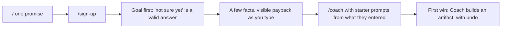
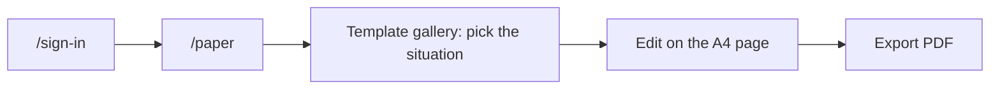
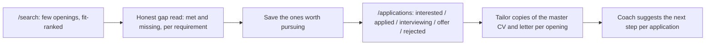
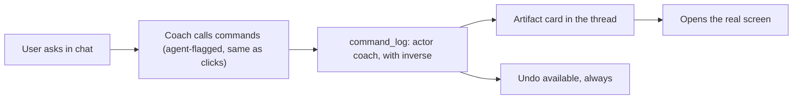
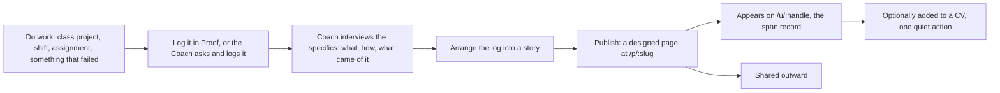

# Information architecture and flows

The conversation is the product; every other screen is an artifact the conversation produced or reads from. Users arrive anxious, in short sessions, often on mid-range Android phones. Every screen must answer "what do I do next" before they leave it.

## Information architecture

| URL | Screen | Access |
|---|---|---|
| `/` | Landing: one promise, start now, waitlist | Public |
| `/sign-in`, `/sign-up` | Auth | Public |
| `/onboarding` | First-run wizard | Signed in, once |
| `/coach` | Home: the conversation | Signed in |
| `/profile` | Facts about the person | Signed in |
| `/paper`, `/paper/$paperId` | Document list, opened document | Signed in |
| `/proof`, `/proof/$proofId` | Evidence space, opened Proof | Signed in |
| `/pitch` | Bio, intro, answer bank | Signed in |
| `/search` | Fit-ranked openings | Signed in |
| `/applications` | Tracker pipeline | Signed in |
| `/settings` | Account, handle, sign out | Signed in |
| `/p/$slug` | One published Proof page | Public |
| `/u/$handle` | Personal page: span record of published Proofs | Public |

The signed-in shell: sidebar (Profile, Paper, Proof, Pitch, Search, Applications, Settings), the coach dock, and the notification bell on every screen. Coach is home — signing in lands on `/coach`.

## Flow 1: first run

Onboarding is 3–5 short steps, always skippable, and pays back visibly as answers land (the profile fills, a readiness signal moves). It seeds the profile; returning users never see it again. The first Coach session must produce one real artifact — usually a first CV from the profile — or the differentiator never lands.

## Flow 2: deadline night

The north star for Paper: a user with a deadline tonight leaves with a CV they can send. The list is how they pick; opening a paper means writing. One primary door on the empty list: start the CV.

## Flow 3: apply loop

Fit is never a bare number: it shows its working ("you meet 4 of 6; missing SQL and one project"), so the gap reads as a to-do, not a verdict. Tailoring always copies; the master never changes underneath the user.

## Flow 4: the Coach operates the app

Consent model: an instruction is consent — "build me a CV" means do it, not ask again. Destructive commands are the exception: the app confirms with the user before the bus runs them. The Coach never says "I've updated it" without a successful tool result.

## Flow 5: the evidence loop (signature)

This loop is the retention engine and the seed of the future social layer (vouches, invitations — schema-ready, not built); its full design is [mechanisms/proof.md](mechanisms/proof.md). The empty Proof space teaches what already counts as evidence: a class project, a shift, an assignment, something that failed. Proof is never required and never shamed; "I don't have one yet" gets suggestions from the profile.

## Empty states

Every empty screen states what this place is for, in one sentence, and offers exactly one primary next step. Empty states are the most-seen screens for an anxious new user; they are specified per feature in [features/](features/) and written in the product voice ([design.md](design.md)).

## Failure states

Honesty is a feature. Offline Coach, a hung turn, an empty reply, a failed export — each is shown plainly with what happened and one next step. No silent failures, no fake progress.
