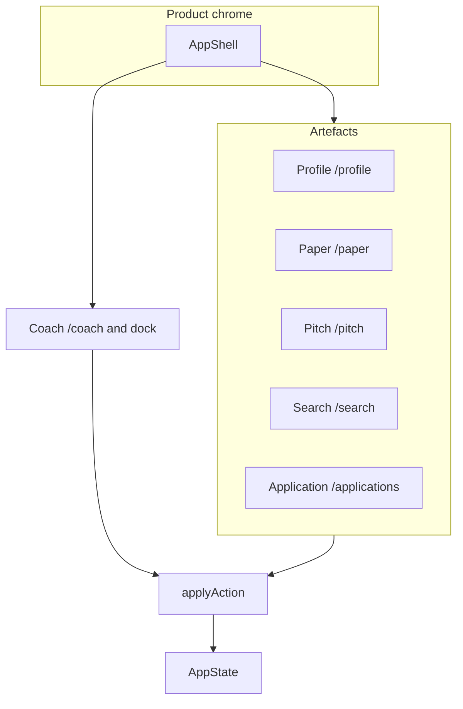

# How a change travels

Chrome → artefacts + Coach → `applyAction` → AppState. Both a click and a Coach turn hit the same registry. Viewport and layout width stay out of AppState.

## Write path

1. UI calls `dispatch` in [`lib/actions/store.tsx`](../lib/actions/store.tsx).
2. Coach tool `apply_action` in [`agent/tools/apply_action.ts`](../agent/tools/apply_action.ts) **validates** the payload and returns `{ ok, action, input, summary }`. It does not mutate.
3. [`components/coach/thread.tsx`](../components/coach/thread.tsx) reads that envelope from the stream and calls the same `dispatch`.
4. `dispatch` runs [`applyAction`](../lib/actions/registry.ts), toasts, offers undo, persists.

The store lives in the tab. That is why the agent cannot write AppState itself. See [ADR 0001](adr/0001-coach-validates-browser-applies.md).

`/coach` and the dock are two layouts of [`useCoach()`](../components/coach/provider.tsx).

## Where each artefact lives

| Artefact | Screen | Domain | AppState | Actions |
|---|---|---|---|---|
| Profile | [`app/(app)/profile/`](../app/(app)/profile/) | [`lib/profile/`](../lib/profile/), [`components/profile/`](../components/profile/), vault kinds in [`lib/catalog.ts`](../lib/catalog.ts) | `profile` | `profile.*`, `document.*` |
| Paper | [`app/(app)/paper/`](../app/(app)/paper/) | [`lib/paper/`](../lib/paper/), [`components/paper/`](../components/paper/) | `paper` | `paper.*` |
| Pitch | [`app/(app)/pitch/`](../app/(app)/pitch/) | [`lib/pitch/`](../lib/pitch/) | `pitch` | `pitch.*` |
| Search | [`app/(app)/search/`](../app/(app)/search/) | [`lib/search/`](../lib/search/) | `openings` | `opening.*` |
| Application | [`app/(app)/applications/`](../app/(app)/applications/) | [`lib/applications/`](../lib/applications/) | `applications` | `application.*` |
| Coach | [`app/(app)/coach/`](../app/(app)/coach/) + dock | [`lib/coach/`](../lib/coach/), [`components/coach/`](../components/coach/) | conversation, not AppState | — |

Profile is in the account menu, not the Prepare rail. Paper is one artefact with types CV, letter, and write-up. Open a paper at `/paper?id=`. There is no `/cv` or `/papers`.

A paper is a discriminated union: CV layout (sections) and letter layout (paragraphs) live inside [`lib/paper/`](../lib/paper/). Callers see `Paper`. See [ADR 0002](adr/0002-paper-is-a-union-of-types.md).

## What is already deep

- The registry and store ([`lib/actions/`](../lib/actions/))
- Auth ([`lib/auth/`](../lib/auth/))
- Billing ([`lib/billing/`](../lib/billing/))
- Persistence: signed-in row vs anonymous localStorage ([`lib/actions/persistence.ts`](../lib/actions/persistence.ts))

## What is five layouts, not five stores

Each artefact screen invented its own chrome. They all `dispatch` into the same AppState. Do not split the registry to match the folders.

Search fit still wraps an Opening as a catalogue-shaped target so it can reuse `fitFor`; the percentage is discarded. Catalogue roles live in [`lib/career-graph.ts`](../lib/career-graph.ts).
