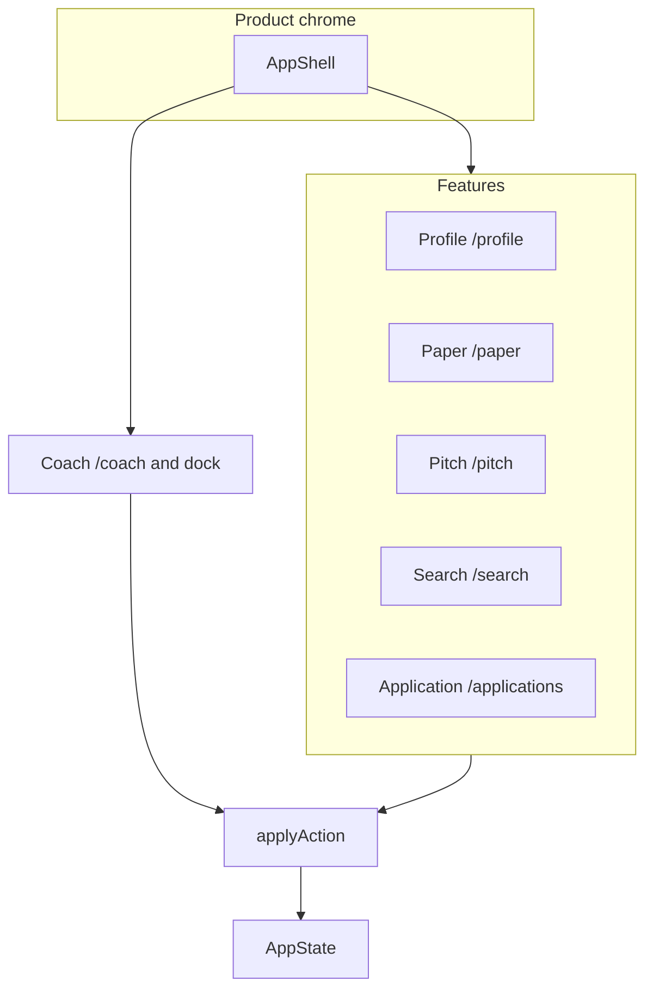

# How a change travels, and where a file goes

Coding agents: read this after [`CONTEXT.md`](../CONTEXT.md). Product nouns live there. Placement lives here.

Chrome → features + Coach → `applyAction` → AppState. A click and a Coach turn hit the same registry. Viewport and layout width stay out of AppState.



## Hierarchy

```
app/(app)/<route>/     thin adapters: page, route-local chrome
components/<name>/     only when two routes share UI
components/ui/         primitives, no product nouns
lib/actions/           the write module: AppState, defineAction, registry, store, persistence
lib/<noun>/            shared domain when two callers exist
lib/<support>/         auth, db, billing, i18n, catalogue, coach, guardrails, onboarding
```

There is no `src/` wrapper, no `features/` tree. A feature is a product noun, not a folder.

**Where a new file goes**

- Mutates AppState → an action on the existing prefix, or a new prefix if the noun is new. Tests call `applyAction`.
- Two callers share it → `lib/<noun>/` or `lib/<support>/`.
- One screen's chrome → `app/(app)/<route>/`.
- Two routes share UI → `components/<name>/`.
- A primitive with no product noun → `components/ui/`.
- Unknown noun, one caller → wait. Do not add an empty folder.

Pitch and Search have no `components/` folder. Do not add empty ones.

## Write path

1. UI calls `dispatch` in [`lib/actions/store.tsx`](../lib/actions/store.tsx).
2. Coach tool `apply_action` in [`agent/tools/apply_action.ts`](../agent/tools/apply_action.ts) **validates** and returns `{ ok, action, input, summary }`. It does not mutate.
3. [`components/coach/thread.tsx`](../components/coach/thread.tsx) reads that envelope and calls the same `dispatch`.
4. `dispatch` runs [`applyAction`](../lib/actions/registry.ts), toasts, offers undo, persists.

The store lives in the tab. A second write path (the tool mutating Postgres, or applying on the server) would fork undo and the account row. So the Coach only validates.

`/coach` and the dock are two layouts of [`useCoach()`](../components/coach/provider.tsx).

Action tables live next to the noun (`lib/paper/actions.ts`, and so on). The registry spreads them. Tailor calls the paper table directly; it does not import `applyAction`. Callers still enter through `applyAction("application.tailor…")`.

## Where each product noun lives

| Noun | Shared domain | Adapters | AppState | Actions |
|---|---|---|---|---|
| Profile | [`lib/profile/`](../lib/profile/) | [`app/(app)/profile/`](../app/(app)/profile/), [`components/profile/`](../components/profile/) | `profile` | `profile.*`, `document.*` |
| Paper | [`lib/paper/`](../lib/paper/) | [`app/(app)/paper/`](../app/(app)/paper/), [`components/paper/`](../components/paper/) | `paper`, `uploads` | `paper.*` |
| Pitch | [`lib/pitch/`](../lib/pitch/) | [`app/(app)/pitch/`](../app/(app)/pitch/) | `pitch` | `pitch.*` |
| Search | [`lib/search/`](../lib/search/) | [`app/(app)/search/`](../app/(app)/search/) | `openings` | `opening.*` |
| Application | [`lib/applications/`](../lib/applications/) | [`app/(app)/applications/`](../app/(app)/applications/) | `applications` | `application.*` |
| Coach | [`lib/coach/`](../lib/coach/) | [`app/(app)/coach/`](../app/(app)/coach/) + dock, [`components/coach/`](../components/coach/) | conversation, not AppState | — |

Profile is in the account menu, not the Prepare rail. `Experience` and `ProfileDocument` live in [`lib/profile/types.ts`](../lib/profile/types.ts); vault kinds stay in [`lib/profile/vault.ts`](../lib/profile/vault.ts). Paper is one feature with types CV, letter, and Proof. Uploads sit beside papers on `uploads`. Open a paper at `/paper?id=`. Public Proofs live at `/p/[slug]`; the personal link is `/u/[handle]`. There is no `/cv` or `/papers`.

A paper is a discriminated union. Layout stays inside [`lib/paper/`](../lib/paper/). Callers see `Paper`. Two features (two routes, two store keys, two action families) would make type look like a product.

## Supporting, not product nouns

[`lib/catalogue/`](../lib/catalogue/) holds shared role archetypes and `Requirement`. Search and the catalogue scorer both use it. There is no Catalogue screen.

[`lib/catalogue/fit.ts`](../lib/catalogue/fit.ts) splits the scorer: `matchRequirements` is met / missing / unprovable from `{ requires }`; `fitFor` adds readiness for a catalogue role. Openings never dress up as a `PathNode`.

Also supporting: [`lib/auth/`](../lib/auth/), [`lib/db/`](../lib/db/), [`lib/billing/`](../lib/billing/), [`lib/i18n/`](../lib/i18n/), [`lib/guardrails/`](../lib/guardrails/), [`lib/onboarding/`](../lib/onboarding/). Ids (`nextId`) live in [`lib/ids.ts`](../lib/ids.ts), not on a product noun. Persistence (anonymous localStorage vs signed-in Postgres) is inside [`lib/actions/persistence.ts`](../lib/actions/persistence.ts).

## Five layouts, not five stores

Each screen invented its own chrome. They all `dispatch` into the same AppState. Do not split the registry to match the folders.

## Docs that stay

`CONTEXT.md`, `DESIGN.md`, `PRODUCT.md`, `README.md`. Hosting is [`docs/hosting.md`](hosting.md). The database is [`docs/database.md`](database.md). Locked My Paper grill answers are [`docs/paper.md`](paper.md). Engineering-skill config is [`docs/agents/`](agents/). Local tickets and specs live under `.scratch/<feature>/`.
