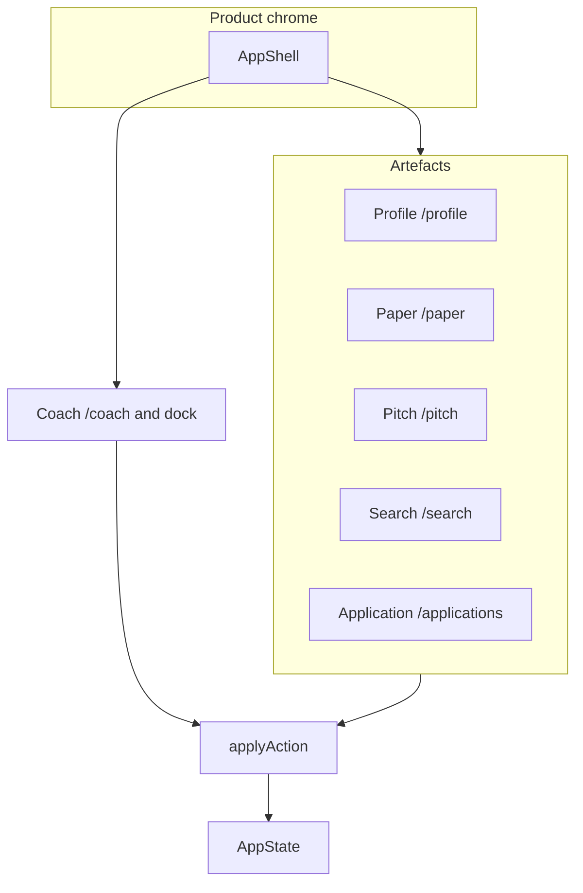

# How a change travels

Chrome → artefacts + Coach → `applyAction` → AppState. Both a click and a Coach turn hit the same registry. Viewport and layout width stay out of AppState.

## Module vs adapter

`lib/<artefact>` is the module. `app/` and `components/` are Next adapters for that module. There is no `src/` wrapper and no `artefacts/` colocation.

Pitch and Search have no `components/` folder: nothing shared needs one. Do not add empty folders to complete a table.

Action tables live next to the artefact (`lib/paper/actions.ts`, and so on). [`lib/actions/registry.ts`](../lib/actions/registry.ts) spreads them into one `applyAction`. Tailor calls the paper table directly; it does not import `applyAction`.

## Write path

1. UI calls `dispatch` in [`lib/actions/store.tsx`](../lib/actions/store.tsx).
2. Coach tool `apply_action` in [`agent/tools/apply_action.ts`](../agent/tools/apply_action.ts) **validates** the payload and returns `{ ok, action, input, summary }`. It does not mutate.
3. [`components/coach/thread.tsx`](../components/coach/thread.tsx) reads that envelope from the stream and calls the same `dispatch`.
4. `dispatch` runs [`applyAction`](../lib/actions/registry.ts), toasts, offers undo, persists.

The store lives in the tab. That is why the agent cannot write AppState itself. See [ADR 0001](adr/0001-coach-validates-browser-applies.md).

`/coach` and the dock are two layouts of [`useCoach()`](../components/coach/provider.tsx).

## Where each artefact lives

| Artefact | Module | Adapters | AppState | Actions |
|---|---|---|---|---|
| Profile | [`lib/profile/`](../lib/profile/) (vault in [`vault.ts`](../lib/profile/vault.ts)) | [`app/(app)/profile/`](../app/(app)/profile/), [`components/profile/`](../components/profile/) | `profile` | `profile.*`, `document.*` |
| Paper | [`lib/paper/`](../lib/paper/) | [`app/(app)/paper/`](../app/(app)/paper/), [`components/paper/`](../components/paper/) | `paper` | `paper.*` |
| Pitch | [`lib/pitch/`](../lib/pitch/) | [`app/(app)/pitch/`](../app/(app)/pitch/) | `pitch` | `pitch.*` |
| Search | [`lib/search/`](../lib/search/) | [`app/(app)/search/`](../app/(app)/search/) | `openings` | `opening.*` |
| Application | [`lib/applications/`](../lib/applications/) | [`app/(app)/applications/`](../app/(app)/applications/) | `applications` | `application.*` |
| Coach | [`lib/coach/`](../lib/coach/) | [`app/(app)/coach/`](../app/(app)/coach/) + dock, [`components/coach/`](../components/coach/) | conversation, not AppState | — |

Profile is in the account menu, not the Prepare rail. Paper is one artefact with types CV, letter, and write-up. Open a paper at `/paper?id=`. There is no `/cv` or `/papers`.

A paper is a discriminated union: CV layout (sections) and letter layout (paragraphs) live inside [`lib/paper/`](../lib/paper/). Callers see `Paper`. See [ADR 0002](adr/0002-paper-is-a-union-of-types.md).

## Supporting, not artefacts

[`lib/catalogue/`](../lib/catalogue/) holds shared role archetypes and the `Requirement` type. Search and the catalogue scorer both use it. There is no Catalogue screen.

[`lib/career-fit.ts`](../lib/career-fit.ts) splits the scorer: `matchRequirements` is met / missing / unprovable from `{ requires }`; `fitFor` adds the readiness term for a catalogue role. Openings never dress up as a `PathNode`.

## What is already deep

- The registry and store ([`lib/actions/`](../lib/actions/))
- Auth ([`lib/auth/`](../lib/auth/))
- Billing ([`lib/billing/`](../lib/billing/))
- Persistence: signed-in row vs anonymous localStorage ([`lib/actions/persistence.ts`](../lib/actions/persistence.ts))

## What is five layouts, not five stores

Each artefact screen invented its own chrome. They all `dispatch` into the same AppState. Do not split the registry to match the folders.

## Working paper, not architecture

[`plans/`](../plans/) is Coach-dock motion notes. Root docs stay: `CONTEXT.md`, `DESIGN.md`, `PRODUCT.md`, `README.md`.
