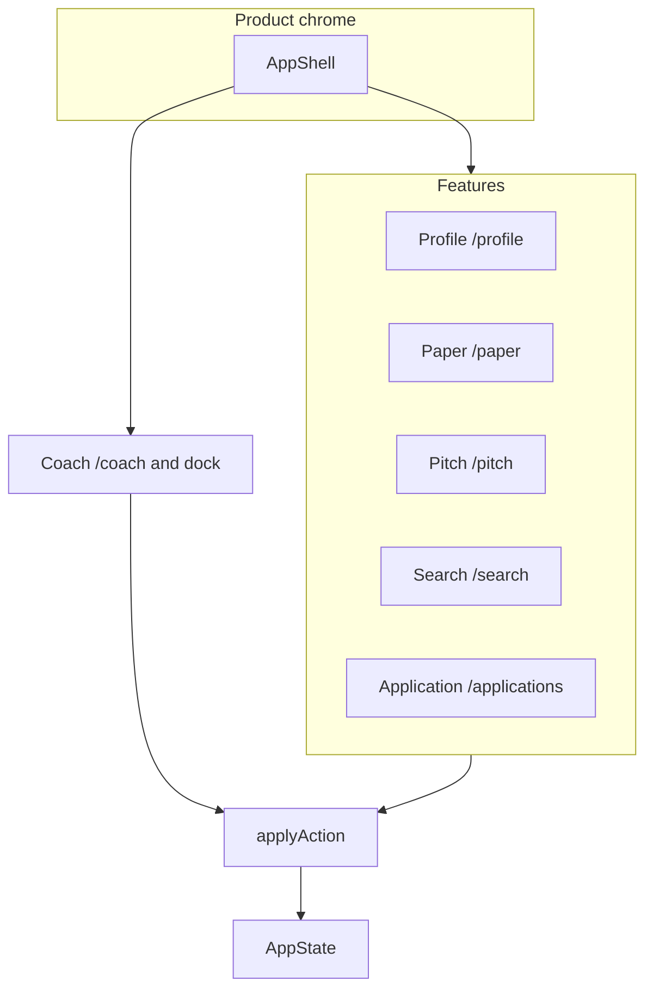

# How a change travels

A click and a Coach turn hit the same registry. That is the whole model.

Read [`CONTEXT.md`](../CONTEXT.md) for the tree and what is true now. This page is placement and the write path.



Viewport and layout width stay out of AppState.

## Write path

1. UI calls `dispatch` in [`src/lib/actions/store.tsx`](../src/lib/actions/store.tsx).
2. The Coach tool [`apply_action`](../agent/tools/apply_action.ts) validates and returns `{ ok, action, input, summary }`. It does not mutate.
3. [`src/components/coach/thread.tsx`](../src/components/coach/thread.tsx) reads that envelope and calls the same `dispatch`.
4. `dispatch` runs [`applyAction`](../src/lib/actions/registry.ts), toasts, offers undo, persists.

The store lives in the tab. A second write path (Query mutating Postgres, or the Coach applying on the server) would fork undo. Query and TanStack DB are satellite reads. Writes still `dispatch`.

`/coach` and the dock are two layouts of [`useCoach()`](../src/components/coach/provider.tsx).

Action tables live next to the noun (`src/lib/paper/actions.ts`). The registry spreads them. Callers enter through `applyAction("application.tailor…")`.

## How to read `src/routes`

This is TanStack Start, not Next.js. File routes use `createFileRoute`. Server-only work goes through `createServerFn` or `server.handlers`. Read Start and Router docs under `node_modules/@tanstack/` before writing routes.

- A file is a URL. `paper/` is `/paper`.
- `_` is a pathless layout. `_signed-in/paper` is still `/paper`.
- `-` is not a URL. `paper/-drive.tsx` is not `/paper/drive`.
- `$` is a URL param. `$slug` is `:slug`.

`_signed-in` is sidebar and Coach dock. `_public` is visitor pages: `/p/:slug` (one published Proof) and `/u/:handle` (personal link).

## Where a new file goes

```
src/routes/__root.tsx           document shell
src/routes/_signed-in.tsx       signed-in chrome
src/routes/_signed-in/<route>   product screen; fat screens are a folder + -files
src/routes/_public/             /p/:slug and /u/:handle
src/routes/api/<name>/          server handlers
src/components/<name>/          UI shared by two routes
src/components/ui/              primitives, no product nouns
src/lib/actions/                AppState, defineAction, registry, store
src/lib/<noun>/                 shared domain
src/lib/<support>/              auth, db, billing, i18n, catalogue, coach, guardrails
```

- Mutates AppState: an action on the existing prefix, or a new prefix if the noun is new. Tests call `applyAction`.
- Two callers share it: `src/lib/<noun>/`.
- One screen's chrome: a `-` file next to that route.
- Two routes share UI: `src/components/<name>/`.
- A primitive: `src/components/ui/`.
- Unknown noun, one caller: wait. Do not add an empty folder.

Pitch and Search have no `components/` folder. Do not add empty ones. A feature is a product noun, not a package. Do not split the registry to match the folders.

## Product nouns

| Noun | Domain | Screen | AppState | Actions |
|---|---|---|---|---|
| Profile | [`src/lib/profile/`](../src/lib/profile/) | [`profile.tsx`](../src/routes/_signed-in/profile.tsx), [`components/profile/`](../src/components/profile/) | `profile` | `profile.*`, `document.*` |
| Paper | [`src/lib/paper/`](../src/lib/paper/) | [`paper/`](../src/routes/_signed-in/paper/), [`components/paper/`](../src/components/paper/) | `paper`, `uploads` | `paper.*` |
| Pitch | [`src/lib/pitch/`](../src/lib/pitch/) | [`pitch.tsx`](../src/routes/_signed-in/pitch.tsx) | `pitch` | `pitch.*` |
| Search | [`src/lib/search/`](../src/lib/search/) | [`search/`](../src/routes/_signed-in/search/) | `openings` | `opening.*` |
| Application | [`src/lib/applications/`](../src/lib/applications/) | [`applications/`](../src/routes/_signed-in/applications/) | `applications` | `application.*` |
| Coach | [`src/lib/coach/`](../src/lib/coach/) | [`coach.tsx`](../src/routes/_signed-in/coach.tsx), dock | conversation, not AppState | none |

Profile is in the account menu. Paper types are CV, letter, and Proof. Uploads sit beside papers. Open a paper at `/paper?id=`. Public Proofs are `/p/:slug`. The personal link is `/u/:handle`. There is no `/cv` or `/papers`.

[`src/lib/catalogue/`](../src/lib/catalogue/) is shared role archetypes. There is no Catalogue screen. Ids live in [`src/lib/ids.ts`](../src/lib/ids.ts).
