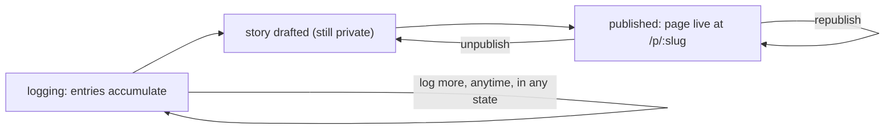

# Proof: the evidence engine

A Proof is a space where a user builds up evidence of work and skill over time — a running log of what actually happened, interviewed into specifics by the Coach, arranged into a story, and published as a page they own. The bet: early-career users do not lack ability, they lack *legible evidence* of ability, and a mechanism that manufactures legibility from ordinary work is worth more than any template.

## Why this exists

Ask a third-year student what they have done and they say "nothing, really." It is almost never true. They ran a club fair, kept a café's closing shift running short-staffed, built a class project that half worked. The evidence exists; it is illegible — uncaptured, unspecific, and unowned. A CV cannot fix this: a CV asserts, and an early CV asserts thinly. Proof *shows*. Nobody clones this because job tools start at the application; Proof starts months earlier, where the evidence is actually made.

The deeper loop: a user who logs work weekly stops asking "am I behind?" and starts asking "what's next?" — the anxiety-to-agency shift the whole product exists for. And published Proofs are the seed of everything social OpenPath will ever build: sharing, invitations, vouches all grow from a page of real work worth showing.

## Principles

1. **Capture close to the moment.** Evidence logged the week it happened has specifics; evidence recalled six months later has adjectives. The log's friction must be near zero.
2. **The user's words are the material.** The Coach asks; it never ghostwrites the raw log. Polish comes at arrange time, and even then only shapes what the user said.
3. **Specifics beat polish.** "The fair had 14 clubs and we ran out of table space" beats "successfully organized a large event" in any interview. The interviewer exists to pull out the former.
4. **Never invent — especially numbers.** "We shortened the intake process" is defensible; "cut time by 40%" that nobody measured is a sentence the user cannot survive being asked about.
5. **Never required, never shame.** Proof is offered, not assigned. No streaks, no guilt, no red numbers. An empty Proof space teaches; it does not scold.
6. **What already counts.** A class project, a shift, an assignment, something that failed — the mechanism's first job is widening the user's definition of evidence.

## The mechanic

### Objects

| Object | What it is |
|---|---|
| The space | A Proof: title, optional role, dates, link. Cheap to create — a title is enough |
| The log | Entries, newest first: notes, links, photos. Append-mostly, editable, the user's verbatim record |
| The story | The arranged draft: what the project was, what they did, what came of it. Lives on the Proof, invisible to the public |
| The page | The published snapshot at `/p/:slug` — frozen at publish, changed only by republishing |

### Beat 1 — Log

One text box, always at the top of an open Proof. Chips suggest entry kinds (note, link, photo) but plain text is enough. The Coach is the second door: it notices evidence in conversation ("we ran the club fair last week") and offers to log it — `proof.log`, with the user's phrasing, confirmation and undo like any command. Logging must feel like texting yourself, not filing a report.

### Beat 2 — Interview

The signature AI behaviour. Given the log so far, the interviewer produces the *next question* that would make the evidence more specific, walking a ladder:

1. **What was it** — scope and stakes: "How many clubs? Whose idea was the layout?"
2. **What did you do** — the user's own hands: "What broke on the day, and what did you do about it?"
3. **What came of it** — outcome, in whatever honest terms exist: "Did the clubs come back next term? Did anyone say anything?"

One question at a time, in chat or in the Proof space. Answers become entries. The interviewer stops when the three parts have substance or the user stops — it never loops for completeness points.

The craft is in the questions. "Tell me more about your responsibilities" is a bad question — it invites adjectives. "What went wrong at the fair and what did you do that afternoon?" is a good question — it can only be answered with specifics. The interviewer prompt encodes this: concrete over abstract, one thing at a time, the user's last entry as the thread to pull.

### Beat 3 — Arrange

The band on an open Proof reads **Arrange**, then **Publish** — never "dump" or "prepare" on screen. Arrange shapes the log into the three-part story using only facts present in the log and profile. If a part is missing, the band says which ("What came of it isn't there yet — one line is enough") and offers the interviewer, not a lorem-ipsum filler. All three parts, or it is not a story yet. The user edits the arranged draft freely; it is theirs.

### Beat 4 — Publish

`proof.publish` snapshots the story to a designed page at `/p/:slug` ([share.md](share.md)). Publishing is explicit and reversible; later edits change nothing until republished, so a shared link never shifts under the reader.

The page is the one expressive surface in the product — photos and considered type allowed — and it has four jobs, in this order: **sound smart** (specific and defensible), **be human** (the user's voice survived), **look considered** (taste, not templates), **feel earned** (nothing inflated). It is never the CV's black-on-white, and never luxury cosplay.

### Beat 5 — Connect

- The personal page `/u/:handle` gains a row in the span record — published work by role and dates.
- **Add to CV** (`paper.addProofLine`) is a separate quiet action, never automatic: one line, chosen by the user.
- The link goes wherever the user sends it — a Zalo message, a LinkedIn post, an email to a recruiter. Distribution is user-owned.

### Lifecycle

Logging never stops being available; a published Proof can keep accumulating entries toward its next republish.

## The AI inside it

Two functions in `features/proof/ai.server.ts` ([ai.md](../ai.md)), both hard-grounded:

- **Interviewer** — input: the Proof, its log, the profile. Output: one question, or "the story has all three parts." Never writes content, never suggests facts, never asks two things at once.
- **Arranger** — input: the log and profile. Output: the three-part story built strictly from provided facts. A fact absent from the input cannot appear in the output; evals test this with planted-omission cases.

The cold-start helper: "I don't have one yet" hands the profile to the Coach, which suggests candidate Proofs from what is already there — that group assignment, that part-time job — and offers to create the space.

## Connection points

Coach (capture, interview, arrange — all through commands with undo), Paper (`paper.addProofLine`), Share (pages, handle, span record), Search and Applications (a named gap like "one project" is an invitation to start a Proof — the honest answer to "what would close this gap"). Notifications stay out of Proof in v1; any future logging nudge is opt-in and gentle or it violates principle 5.

## Growth roadmap

- **v1** — the five beats above: log, interview, arrange, publish, connect.
- **v-next: vouches.** An invite token ([share.md](share.md), capability `vouch`) lets a named person — teammate, group leader, shift manager — confirm a Proof in one tap, with their name and relationship on the page. Earned credibility, the thing a template can never fake.
- **v-next: rhythm.** An opt-in weekly question from the Coach: "What did you make this week?" One notification, one tap to log or dismiss. Cadence without streaks.
- **v-later: invitations and audiences.** Private views for a specific employer, a Proof shared before publishing for feedback, collections of Proofs for one application.
- **v-later, only if earned: discovery.** Proofs findable beyond the user's own links. Enters only with the same guarantees — no feed mechanics, no vanity metrics, nothing that makes a seventeen-entry Proof feel small.

Each of these is new commands and new `shares` capabilities on existing rails — additions, not rewrites ([ADR 0005](../adr/0005-proof-own-domain.md)).

## What would kill it

- **Shame.** One guilt-tinted empty state or streak counter and the anxious user this is for never comes back.
- **Fabrication.** One invented number in an arranged story destroys the entire premise — evidence that cannot be defended is worse than no evidence.
- **Requirement.** The moment a Proof is needed to use the rest of the product, it becomes homework.
- **Ghostwriting.** If the arranged story stops sounding like the user, the page stops being proof of anything.
- **Social-first drift.** Building the feed before the evidence habit exists would make it a worse LinkedIn instead of the first real Proof engine.

## Success signals

- Proofs that reach three or more entries — the habit measure.
- Share of active users who log in a given week — the rhythm measure.
- Published Proofs, and pages visited through user-shared links — the pride measure (they sent it to someone).
- Proof lines added to CVs, and interview answers in Pitch that cite a Proof — the payoff measure.
- In arranged stories: zero facts not present in the log. An eval, not a metric — and it must stay at zero.
