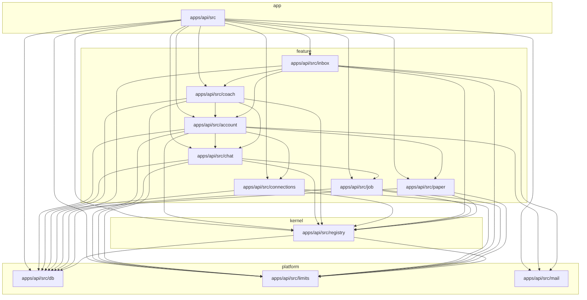

# Packs

`ts-packwerk docs --out` writes this page from every `pack.yml`, and `ts-packwerk docs --check` fails when it is stale.

| Pack | Layer | Public | Dependencies | Tables |
| --- | --- | --- | --- | --- |
| `apps/api/src` | app | index.ts | apps/api/src/account, apps/api/src/chat, apps/api/src/coach, apps/api/src/connections, apps/api/src/inbox, apps/api/src/job, apps/api/src/paper, apps/api/src/registry, apps/api/src/db, apps/api/src/mail, apps/api/src/limits | none |
| `apps/api/src/account` | feature | index.ts | apps/api/src/chat, apps/api/src/paper, apps/api/src/connections, apps/api/src/registry, apps/api/src/db, apps/api/src/limits, apps/api/src/mail | none |
| `apps/api/src/chat` | feature | index.ts | apps/api/src/job, apps/api/src/registry, apps/api/src/db, apps/api/src/limits | none |
| `apps/api/src/coach` | feature | index.ts | apps/api/src/chat, apps/api/src/account, apps/api/src/registry, apps/api/src/db, apps/api/src/limits | none |
| `apps/api/src/connections` | feature | index.ts | apps/api/src/registry, apps/api/src/db, apps/api/src/limits | none |
| `apps/api/src/db` | platform | none | none | none |
| `apps/api/src/inbox` | feature | index.ts | apps/api/src/account, apps/api/src/coach, apps/api/src/registry, apps/api/src/db, apps/api/src/limits, apps/api/src/mail | none |
| `apps/api/src/job` | feature | index.ts | apps/api/src/registry, apps/api/src/db, apps/api/src/limits | none |
| `apps/api/src/limits` | platform | index.ts | none | none |
| `apps/api/src/mail` | platform | none | none | none |
| `apps/api/src/paper` | feature | index.ts | apps/api/src/registry, apps/api/src/db, apps/api/src/limits | none |
| `apps/api/src/registry` | kernel | none | apps/api/src/db, apps/api/src/limits | none |
