# Packs

`ts-packwerk docs --out` writes this page from every `pack.yml`, and `ts-packwerk docs --check` fails when it is stale.

```mermaid
flowchart TD
  subgraph p_layer_app["app"]
    p_apps_api_src["apps/api/src"]
    p_apps_web_src["apps/web/src"]
  end
  subgraph p_layer_shell["shell"]
    p_apps_web_src_features_app_shell["apps/web/src/features/app-shell"]
  end
  subgraph p_layer_feature["feature"]
    p_apps_api_src_account["apps/api/src/account"]
    p_apps_api_src_coach["apps/api/src/coach"]
    p_apps_api_src_coach_chat["apps/api/src/coach/chat"]
    p_apps_api_src_connections["apps/api/src/connections"]
    p_apps_api_src_inbox["apps/api/src/inbox"]
    p_apps_api_src_job["apps/api/src/job"]
    p_apps_api_src_paper["apps/api/src/paper"]
    p_apps_api_src_paper_content["apps/api/src/paper/content"]
    p_apps_api_src_paper_import["apps/api/src/paper/import"]
    p_apps_api_src_paper_log["apps/api/src/paper/log"]
    p_apps_api_src_paper_native_output["apps/api/src/paper/native-output"]
    p_apps_api_src_paper_pdf["apps/api/src/paper/pdf"]
    p_apps_api_src_paper_word["apps/api/src/paper/word"]
    p_apps_web_src_features_apply["apps/web/src/features/apply"]
    p_apps_web_src_features_auth["apps/web/src/features/auth"]
    p_apps_web_src_features_coach["apps/web/src/features/coach"]
    p_apps_web_src_features_coming_soon["apps/web/src/features/coming-soon"]
    p_apps_web_src_features_command_palette["apps/web/src/features/command-palette"]
    p_apps_web_src_features_connections["apps/web/src/features/connections"]
    p_apps_web_src_features_inbox["apps/web/src/features/inbox"]
    p_apps_web_src_features_landing["apps/web/src/features/landing"]
    p_apps_web_src_features_paper["apps/web/src/features/paper"]
    p_apps_web_src_features_paper_page["apps/web/src/features/paper-page"]
    p_apps_web_src_features_paper_editor["apps/web/src/features/paper/editor"]
    p_apps_web_src_features_paper_rich_editor["apps/web/src/features/paper/rich-editor"]
    p_apps_web_src_features_seed["apps/web/src/features/seed"]
    p_apps_web_src_features_settings["apps/web/src/features/settings"]
  end
  subgraph p_layer_kernel["kernel"]
    p_apps_api_src_registry["apps/api/src/registry"]
  end
  subgraph p_layer_platform["platform"]
    p_apps_api_src_db["apps/api/src/db"]
    p_apps_api_src_limits["apps/api/src/limits"]
    p_apps_api_src_mail["apps/api/src/mail"]
    p_apps_api_src_platform["apps/api/src/platform"]
    p_apps_web_src_components["apps/web/src/components"]
    p_apps_web_src_lib["apps/web/src/lib"]
    p_packages_domain_src_account["packages/domain/src/account"]
    p_packages_domain_src_agents["packages/domain/src/agents"]
    p_packages_domain_src_apply["packages/domain/src/apply"]
    p_packages_domain_src_coach["packages/domain/src/coach"]
    p_packages_domain_src_control["packages/domain/src/control"]
    p_packages_domain_src_inbox["packages/domain/src/inbox"]
    p_packages_domain_src_paper_doc["packages/domain/src/paper-doc"]
    p_packages_paper_corpus["packages/paper-corpus"]
    p_packages_paper_engine["packages/paper-engine"]
    p_packages_paper_engine_src_layout["packages/paper-engine/src/layout"]
    p_packages_paper_fonts["packages/paper-fonts"]
  end
  p_apps_api_src --> p_apps_api_src_account
  p_apps_api_src --> p_apps_api_src_coach_chat
  p_apps_api_src --> p_apps_api_src_coach
  p_apps_api_src --> p_apps_api_src_connections
  p_apps_api_src --> p_apps_api_src_inbox
  p_apps_api_src --> p_apps_api_src_job
  p_apps_api_src --> p_apps_api_src_paper
  p_apps_api_src --> p_apps_api_src_registry
  p_apps_api_src --> p_apps_api_src_db
  p_apps_api_src --> p_apps_api_src_mail
  p_apps_api_src --> p_apps_api_src_limits
  p_apps_api_src --> p_apps_api_src_platform
  p_apps_api_src_account --> p_apps_api_src_coach_chat
  p_apps_api_src_account --> p_apps_api_src_paper
  p_apps_api_src_account --> p_apps_api_src_connections
  p_apps_api_src_account --> p_apps_api_src_registry
  p_apps_api_src_account --> p_apps_api_src_db
  p_apps_api_src_account --> p_apps_api_src_limits
  p_apps_api_src_account --> p_apps_api_src_mail
  p_apps_api_src_account --> p_apps_api_src_platform
  p_apps_api_src_coach --> p_apps_api_src_coach_chat
  p_apps_api_src_coach --> p_apps_api_src_account
  p_apps_api_src_coach --> p_apps_api_src_registry
  p_apps_api_src_coach --> p_apps_api_src_db
  p_apps_api_src_coach --> p_apps_api_src_limits
  p_apps_api_src_coach --> p_apps_api_src_platform
  p_apps_api_src_coach_chat --> p_apps_api_src_job
  p_apps_api_src_coach_chat --> p_apps_api_src_registry
  p_apps_api_src_coach_chat --> p_apps_api_src_db
  p_apps_api_src_coach_chat --> p_apps_api_src_limits
  p_apps_api_src_coach_chat --> p_apps_api_src_platform
  p_apps_api_src_connections --> p_apps_api_src_registry
  p_apps_api_src_connections --> p_apps_api_src_db
  p_apps_api_src_connections --> p_apps_api_src_limits
  p_apps_api_src_connections --> p_apps_api_src_platform
  p_apps_api_src_db --> p_apps_api_src_platform
  p_apps_api_src_inbox --> p_apps_api_src_account
  p_apps_api_src_inbox --> p_apps_api_src_coach
  p_apps_api_src_inbox --> p_apps_api_src_registry
  p_apps_api_src_inbox --> p_apps_api_src_db
  p_apps_api_src_inbox --> p_apps_api_src_limits
  p_apps_api_src_inbox --> p_apps_api_src_mail
  p_apps_api_src_inbox --> p_apps_api_src_platform
  p_apps_api_src_job --> p_apps_api_src_registry
  p_apps_api_src_job --> p_apps_api_src_db
  p_apps_api_src_job --> p_apps_api_src_limits
  p_apps_api_src_job --> p_apps_api_src_platform
  p_apps_api_src_paper --> p_apps_api_src_paper_import
  p_apps_api_src_paper --> p_apps_api_src_paper_log
  p_apps_api_src_paper --> p_apps_api_src_paper_native_output
  p_apps_api_src_paper --> p_apps_api_src_paper_content
  p_apps_api_src_paper --> p_apps_api_src_registry
  p_apps_api_src_paper --> p_apps_api_src_db
  p_apps_api_src_paper --> p_apps_api_src_limits
  p_apps_api_src_paper --> p_apps_api_src_platform
  p_apps_api_src_paper_content --> p_apps_api_src_db
  p_apps_api_src_paper_content --> p_apps_api_src_platform
  p_apps_api_src_paper_import --> p_apps_api_src_platform
  p_apps_api_src_paper_log --> p_apps_api_src_db
  p_apps_api_src_paper_log --> p_packages_paper_engine
  p_apps_api_src_paper_pdf --> p_packages_paper_engine
  p_apps_api_src_paper_word --> p_apps_api_src_paper_import
  p_apps_api_src_registry --> p_apps_api_src_db
  p_apps_api_src_registry --> p_apps_api_src_limits
  p_apps_api_src_registry --> p_apps_api_src_platform
  p_apps_web_src --> p_apps_web_src_features_app_shell
  p_apps_web_src --> p_apps_web_src_features_apply
  p_apps_web_src --> p_apps_web_src_features_auth
  p_apps_web_src --> p_apps_web_src_features_coach
  p_apps_web_src --> p_apps_web_src_features_coming_soon
  p_apps_web_src --> p_apps_web_src_features_command_palette
  p_apps_web_src --> p_apps_web_src_features_connections
  p_apps_web_src --> p_apps_web_src_features_inbox
  p_apps_web_src --> p_apps_web_src_features_landing
  p_apps_web_src --> p_apps_web_src_features_paper
  p_apps_web_src --> p_apps_web_src_features_paper_editor
  p_apps_web_src --> p_apps_web_src_features_paper_rich_editor
  p_apps_web_src --> p_apps_web_src_features_paper_page
  p_apps_web_src --> p_apps_web_src_features_seed
  p_apps_web_src --> p_apps_web_src_features_settings
  p_apps_web_src --> p_apps_web_src_lib
  p_apps_web_src --> p_apps_web_src_components
  p_apps_web_src_components --> p_apps_web_src_lib
  p_apps_web_src_features_app_shell --> p_apps_web_src_features_apply
  p_apps_web_src_features_app_shell --> p_apps_web_src_features_auth
  p_apps_web_src_features_app_shell --> p_apps_web_src_features_coach
  p_apps_web_src_features_app_shell --> p_apps_web_src_features_command_palette
  p_apps_web_src_features_app_shell --> p_apps_web_src_features_inbox
  p_apps_web_src_features_app_shell --> p_apps_web_src_features_paper
  p_apps_web_src_features_app_shell --> p_apps_web_src_features_seed
  p_apps_web_src_features_app_shell --> p_apps_web_src_lib
  p_apps_web_src_features_app_shell --> p_apps_web_src_components
  p_apps_web_src_features_apply --> p_apps_web_src_lib
  p_apps_web_src_features_apply --> p_apps_web_src_components
  p_apps_web_src_features_auth --> p_apps_web_src_lib
  p_apps_web_src_features_auth --> p_apps_web_src_components
  p_apps_web_src_features_coach --> p_apps_web_src_lib
  p_apps_web_src_features_coach --> p_apps_web_src_components
  p_apps_web_src_features_coming_soon --> p_apps_web_src_lib
  p_apps_web_src_features_coming_soon --> p_apps_web_src_components
  p_apps_web_src_features_command_palette --> p_apps_web_src_lib
  p_apps_web_src_features_command_palette --> p_apps_web_src_components
  p_apps_web_src_features_connections --> p_apps_web_src_lib
  p_apps_web_src_features_connections --> p_apps_web_src_components
  p_apps_web_src_features_inbox --> p_apps_web_src_features_apply
  p_apps_web_src_features_inbox --> p_apps_web_src_lib
  p_apps_web_src_features_inbox --> p_apps_web_src_components
  p_apps_web_src_features_landing --> p_apps_web_src_lib
  p_apps_web_src_features_landing --> p_apps_web_src_components
  p_apps_web_src_features_paper --> p_apps_web_src_features_apply
  p_apps_web_src_features_paper --> p_apps_web_src_features_coach
  p_apps_web_src_features_paper --> p_apps_web_src_features_paper_editor
  p_apps_web_src_features_paper --> p_apps_web_src_features_paper_page
  p_apps_web_src_features_paper --> p_apps_web_src_features_seed
  p_apps_web_src_features_paper --> p_apps_web_src_lib
  p_apps_web_src_features_paper --> p_apps_web_src_components
  p_apps_web_src_features_paper_page --> p_apps_web_src_lib
  p_apps_web_src_features_paper_page --> p_apps_web_src_components
  p_apps_web_src_features_paper_editor --> p_packages_paper_engine
  p_apps_web_src_features_paper_editor --> p_packages_domain_src_paper_doc
  p_apps_web_src_features_paper_editor --> p_packages_paper_corpus
  p_apps_web_src_features_paper_editor --> p_apps_web_src_lib
  p_apps_web_src_features_paper_rich_editor --> p_apps_web_src_features_paper
  p_apps_web_src_features_paper_rich_editor --> p_apps_web_src_features_paper_page
  p_apps_web_src_features_paper_rich_editor --> p_apps_web_src_features_coach
  p_apps_web_src_features_paper_rich_editor --> p_apps_web_src_lib
  p_apps_web_src_features_paper_rich_editor --> p_apps_web_src_components
  p_apps_web_src_features_seed --> p_apps_web_src_lib
  p_apps_web_src_features_seed --> p_apps_web_src_components
  p_apps_web_src_features_settings --> p_apps_web_src_features_auth
  p_apps_web_src_features_settings --> p_apps_web_src_features_connections
  p_apps_web_src_features_settings --> p_apps_web_src_lib
  p_apps_web_src_features_settings --> p_apps_web_src_components
  p_packages_domain_src_account --> p_packages_domain_src_apply
  p_packages_domain_src_account --> p_packages_domain_src_coach
  p_packages_domain_src_coach --> p_packages_domain_src_apply
  p_packages_domain_src_coach --> p_packages_domain_src_paper_doc
  p_packages_domain_src_inbox --> p_packages_domain_src_apply
  p_packages_paper_engine --> p_packages_domain_src_paper_doc
  p_packages_paper_engine --> p_packages_paper_engine_src_layout
  p_packages_paper_engine_src_layout --> p_packages_domain_src_paper_doc
  p_packages_paper_engine_src_layout --> p_packages_paper_fonts
```

| Pack | Layer | Public | Dependencies | Tables |
| --- | --- | --- | --- | --- |
| `apps/api/src` | app | index.ts | apps/api/src/account, apps/api/src/coach/chat, apps/api/src/coach, apps/api/src/connections, apps/api/src/inbox, apps/api/src/job, apps/api/src/paper, apps/api/src/registry, apps/api/src/db, apps/api/src/mail, apps/api/src/limits, apps/api/src/platform | none |
| `apps/api/src/account` | feature | index.ts, operations | apps/api/src/coach/chat, apps/api/src/paper, apps/api/src/connections, apps/api/src/registry, apps/api/src/db, apps/api/src/limits, apps/api/src/mail, apps/api/src/platform | none |
| `apps/api/src/coach` | feature | index.ts, operations | apps/api/src/coach/chat, apps/api/src/account, apps/api/src/registry, apps/api/src/db, apps/api/src/limits, apps/api/src/platform | none |
| `apps/api/src/coach/chat` | feature | index.ts | apps/api/src/job, apps/api/src/registry, apps/api/src/db, apps/api/src/limits, apps/api/src/platform | none |
| `apps/api/src/connections` | feature | index.ts, operations | apps/api/src/registry, apps/api/src/db, apps/api/src/limits, apps/api/src/platform | none |
| `apps/api/src/db` | platform | none | apps/api/src/platform | none |
| `apps/api/src/inbox` | feature | index.ts, operations | apps/api/src/account, apps/api/src/coach, apps/api/src/registry, apps/api/src/db, apps/api/src/limits, apps/api/src/mail, apps/api/src/platform | none |
| `apps/api/src/job` | feature | index.ts, operations | apps/api/src/registry, apps/api/src/db, apps/api/src/limits, apps/api/src/platform | none |
| `apps/api/src/limits` | platform | index.ts | none | none |
| `apps/api/src/mail` | platform | none | none | none |
| `apps/api/src/paper` | feature | index.ts, operations | apps/api/src/paper/import, apps/api/src/paper/log, apps/api/src/paper/native-output, apps/api/src/paper/content, apps/api/src/registry, apps/api/src/db, apps/api/src/limits, apps/api/src/platform | none |
| `apps/api/src/paper/content` | feature | content-store.ts, native-admission.ts, read-paper.ts, rich-snapshot.ts | apps/api/src/db, apps/api/src/platform | none |
| `apps/api/src/paper/import` | feature | import-parse.ts, import-text-pool.ts, import-word.ts, package-xml.ts, package-zip.ts, word-to-paper.ts | apps/api/src/platform | none |
| `apps/api/src/paper/log` | feature | index.ts | apps/api/src/db, packages/paper-engine | none |
| `apps/api/src/paper/native-output` | feature | formatted.ts, formatted-photos.ts | none | none |
| `apps/api/src/paper/pdf` | feature | write-pdf.ts | packages/paper-engine | none |
| `apps/api/src/paper/word` | feature | read-docx.ts, write-docx.ts | apps/api/src/paper/import | none |
| `apps/api/src/platform` | platform | none | none | none |
| `apps/api/src/registry` | kernel | none | apps/api/src/db, apps/api/src/limits, apps/api/src/platform | none |
| `apps/web/src` | app | none | apps/web/src/features/app-shell, apps/web/src/features/apply, apps/web/src/features/auth, apps/web/src/features/coach, apps/web/src/features/coming-soon, apps/web/src/features/command-palette, apps/web/src/features/connections, apps/web/src/features/inbox, apps/web/src/features/landing, apps/web/src/features/paper, apps/web/src/features/paper/editor, apps/web/src/features/paper/rich-editor, apps/web/src/features/paper-page, apps/web/src/features/seed, apps/web/src/features/settings, apps/web/src/lib, apps/web/src/components | none |
| `apps/web/src/components` | platform | none | apps/web/src/lib | none |
| `apps/web/src/features/app-shell` | shell | app-shell-layout.tsx, not-found-page.tsx | apps/web/src/features/apply, apps/web/src/features/auth, apps/web/src/features/coach, apps/web/src/features/command-palette, apps/web/src/features/inbox, apps/web/src/features/paper, apps/web/src/features/seed, apps/web/src/lib, apps/web/src/components | none |
| `apps/web/src/features/apply` | feature | apply-api.ts, apply-board-empty.tsx, apply-board.tsx, apply-calendar.tsx, apply-job-detail.tsx, apply-list.tsx, apply-new-job-dialog.tsx, apply-next-up-strip.tsx, apply-peek.tsx, apply-search.ts, apply-stages.ts, apply-toolbar.tsx | apps/web/src/lib, apps/web/src/components | none |
| `apps/web/src/features/auth` | feature | code-input.tsx, session-check-notice.tsx, shell-overlays.tsx, sign-in-screen.tsx | apps/web/src/lib, apps/web/src/components | none |
| `apps/web/src/features/coach` | feature | chat-api.ts, chat-store-context.ts, chat-store.tsx, coach-panel-chat-report.tsx, coach-panel.tsx, coach-workspace.tsx, use-chat-store.ts | apps/web/src/lib, apps/web/src/components | none |
| `apps/web/src/features/coming-soon` | feature | pages.tsx | apps/web/src/lib, apps/web/src/components | none |
| `apps/web/src/features/command-palette` | feature | command-palette.tsx, shell-chat.ts | apps/web/src/lib, apps/web/src/components | none |
| `apps/web/src/features/connections` | feature | index.ts | apps/web/src/lib, apps/web/src/components | none |
| `apps/web/src/features/inbox` | feature | inbox-api.ts, inbox-page.tsx | apps/web/src/features/apply, apps/web/src/lib, apps/web/src/components | none |
| `apps/web/src/features/landing` | feature | about/about-page.tsx, blog/blog-copy.ts, blog/blog-index.tsx, blog/blog-post.tsx, help/help-page.tsx, landing-page.tsx, landing-pricing.tsx, landing-stories-page.tsx | apps/web/src/lib, apps/web/src/components | none |
| `apps/web/src/features/paper` | feature | paper-api.ts, paper-library.tsx, paper-templates.ts, document-share.tsx, design/paper-writing-page.css, paper-letter-stopped-rich.tsx | apps/web/src/features/apply, apps/web/src/features/coach, apps/web/src/features/paper/editor, apps/web/src/features/paper-page, apps/web/src/features/seed, apps/web/src/lib, apps/web/src/components | none |
| `apps/web/src/features/paper-page` | feature | document-chrome.tsx | apps/web/src/lib, apps/web/src/components | none |
| `apps/web/src/features/paper/editor` | feature | paper-editor.ts, lab-documents.ts, chrome/paper-chrome.tsx, thumbnail.ts | packages/paper-engine, packages/domain/src/paper-doc, packages/paper-corpus, apps/web/src/lib | none |
| `apps/web/src/features/paper/rich-editor` | feature | rich-page.tsx | apps/web/src/features/paper, apps/web/src/features/paper-page, apps/web/src/features/coach, apps/web/src/lib, apps/web/src/components | none |
| `apps/web/src/features/seed` | feature | sample-author.ts | apps/web/src/lib, apps/web/src/components | none |
| `apps/web/src/features/settings` | feature | account-section.tsx, billing-section.tsx, coach-section.tsx, integrations-section.tsx, preferences-section.tsx, sections.ts, settings-api.ts, settings-layout.tsx, settings-nav.tsx, usage-section.tsx | apps/web/src/features/auth, apps/web/src/features/connections, apps/web/src/lib, apps/web/src/components | none |
| `apps/web/src/lib` | platform | none | none | none |
| `packages/domain/src/account` | platform | public.ts, account.ts, usage.ts | packages/domain/src/apply, packages/domain/src/coach | none |
| `packages/domain/src/agents` | platform | public.ts, connections.ts, delegate-grant.ts | none | none |
| `packages/domain/src/apply` | platform | public.ts, job.ts, job-position.ts, job-posting.ts | none | none |
| `packages/domain/src/coach` | platform | public.ts, coach.ts, coach-mode.ts, coach-task.ts, chat.ts, chat-messages.ts, chat-title.ts, chat-turn.ts, chat-views.ts | packages/domain/src/apply, packages/domain/src/paper-doc | none |
| `packages/domain/src/control` | platform | public.ts, control.ts | none | none |
| `packages/domain/src/inbox` | platform | public.ts, index.ts | packages/domain/src/apply | none |
| `packages/domain/src/paper-doc` | platform | public.ts, index.ts, paper.ts, paper-contract.ts, paper-contract-views.ts, paper-diff.ts, paper-rich-edit.ts, paper-start.ts, paper-page-scale.ts, paper-presentation.ts | none | none |
| `packages/paper-corpus` | platform | tests/fixtures/cvs/en-10.expected.json, tests/fixtures/cvs/vi-01.expected.json | none | none |
| `packages/paper-engine` | platform | src/index.ts | packages/domain/src/paper-doc, packages/paper-engine/src/layout | none |
| `packages/paper-engine/src/layout` | platform | index.ts | packages/domain/src/paper-doc, packages/paper-fonts | none |
| `packages/paper-fonts` | platform | fonts.json, metrics | none | none |
